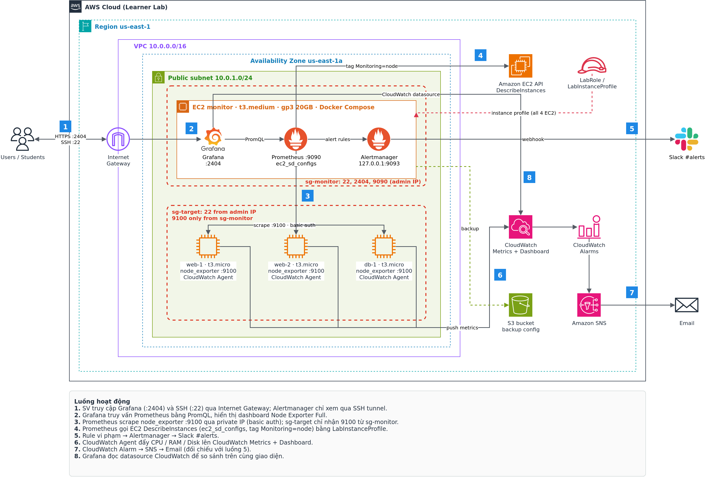

# Báo cáo Tuần 1 – Tìm hiểu dịch vụ, thiết kế kiến trúc, dựng nền tảng

**Đề tài:** Hệ thống giám sát mã nguồn mở Prometheus + Grafana trên AWS (Nhóm: Infrastructure)
**GVHD:** Huỳnh Xuân Phụng
**Thời gian:** ……/……/2026 – ……/……/2026
**Thành viên:** SV A – MSSV ……… · SV B – MSSV ………
**Region:** us-east-1 · **Account ID:** ………………

---

## 1. Mục tiêu tuần

- Tìm hiểu các dịch vụ AWS và các thành phần mã nguồn mở sử dụng trong đề tài.
- Thiết kế kiến trúc tổng thể, vẽ sơ đồ.
- Dựng nền tảng mạng và lưu trữ: VPC, Subnet, Internet Gateway, Route Table, Security Group, S3, Key pair.
- Thống nhất quy ước gắn tag cho mọi tài nguyên.

## 2. Tìm hiểu dịch vụ

### 2.1 Dịch vụ AWS

| Dịch vụ | Vai trò trong đề tài |
|---|---|
| Amazon EC2 | 1 máy monitor chạy Prometheus/Grafana/Alertmanager (Docker), 3 máy target chạy node_exporter |
| Amazon EBS (gp3) | Ổ đĩa gốc cho EC2, lưu dữ liệu TSDB của Prometheus và Grafana |
| Amazon VPC | Mạng riêng 10.0.0.0/16, public subnet, Internet Gateway, Security Group |
| IAM (LabRole / LabInstanceProfile) | Cấp quyền cho EC2 gọi `ec2:DescribeInstances` (service discovery) và CloudWatch, không tạo IAM user/role mới |
| Amazon CloudWatch | Thu metric EC2 (basic/detailed), CloudWatch Agent cho RAM/Disk, Dashboard, Alarm – dùng để so sánh |
| Amazon SNS | Gửi email khi CloudWatch Alarm kích hoạt |
| Amazon S3 | Lưu backup cấu hình và dashboard export |

### 2.2 Thành phần mã nguồn mở

| Thành phần | Phiên bản | Vai trò |
|---|---|---|
| Prometheus | v2.46.0 | Thu thập (pull) và lưu trữ metric dạng time-series, đánh giá alert rule |
| node_exporter | v1.12.1 | Xuất metric hệ điều hành (CPU, RAM, Disk, Network) tại cổng 9100 |
| Alertmanager | v0.25.0 | Gom nhóm, chống trùng, định tuyến cảnh báo đến Slack |
| Grafana | 10.0.5 | Trực quan hóa metric từ Prometheus và CloudWatch |
| Docker Compose | – | Đóng gói và chạy 3 dịch vụ trên EC2 monitor |

### 2.3 So sánh mô hình thu thập (ghi chú tìm hiểu)

- **Prometheus – Pull:** Prometheus chủ động scrape `/metrics` của từng target theo `scrape_interval` (15s).
- **CloudWatch – Push:** Hypervisor (metric mặc định) và CloudWatch Agent đẩy metric lên CloudWatch; chu kỳ mặc định 5 phút, detailed monitoring 1 phút.
- **Metric mặc định của CloudWatch không có RAM và Disk usage** → cần cài CloudWatch Agent (custom metrics, có tính phí).

## 3. Thiết kế kiến trúc



Sơ đồ nguồn: [`docs/architecture.drawio`](../architecture.drawio)

**Luồng hoạt động:**
1. SV truy cập Grafana (:2404) và SSH (:22) qua Internet Gateway; Alertmanager chỉ xem qua SSH tunnel.
2. Grafana truy vấn Prometheus bằng PromQL, hiển thị dashboard Node Exporter Full.
3. Prometheus scrape node_exporter :9100 qua private IP (basic auth); sg-target chỉ nhận 9100 từ sg-monitor.
4. Prometheus gọi EC2 DescribeInstances (`ec2_sd_configs`, tag `Monitoring=node`) bằng LabInstanceProfile.
5. Rule vi phạm → Alertmanager → Slack #alerts.
6. CloudWatch Agent đẩy CPU / RAM / Disk lên CloudWatch Metrics + Dashboard.
7. CloudWatch Alarm → SNS → Email (đối chiếu với luồng 5).
8. Grafana đọc datasource CloudWatch để so sánh trên cùng giao diện.

### 3.1 Danh sách tài nguyên dự kiến và kiểm tra giới hạn Learner Lab

| Tài nguyên | Loại | vCPU | EBS |
|---|---|---|---|
| monitor | t3.medium | 2 | 20 GB gp3 |
| web-1 | t3.micro | 2 | 8 GB gp3 |
| web-2 | t3.micro | 2 | 8 GB gp3 |
| db-1 | t3.micro | 2 | 8 GB gp3 |
| **Tổng** | **4 EC2** | **8 vCPU** | **44 GB** |

| Ràng buộc đề tài | Giới hạn | Thiết kế | Đạt |
|---|---|---|---|
| Số EC2 của đề tài | ≤ 4 | 4 | ✔ |
| Loại instance | nano → large | micro, medium | ✔ |
| vCPU đồng thời / Region | ≤ 32 | 8 | ✔ |
| Tổng EBS | ≤ 100 GB, gp2/gp3 | 44 GB gp3 | ✔ |
| Region | us-east-1 / us-west-2 | us-east-1 | ✔ |
| IAM | Chỉ LabRole/LabInstanceProfile | LabInstanceProfile | ✔ |

### 3.2 Quy ước tag

| Key | Value |
|---|---|
| Project | prom-monitoring |
| Owner | <MSSV người tạo> |
| Name | monitor / web-1 / web-2 / db-1 / tên tài nguyên |
| Monitoring | node *(chỉ 3 máy target – dùng cho service discovery)* |

## 4. Dựng nền tảng

### 4.1 Khởi động Learner Lab

1. Vào AWS Academy → Learner Lab → **Start Lab**, chờ đèn xanh → **AWS**.
2. Chọn Region **N. Virginia (us-east-1)** ở góc trên phải.

> **[ẢNH 1.1] Console Learner Lab đã đăng nhập**
> - Chụp tại: trang **Console Home** (`https://us-east-1.console.aws.amazon.com/console/home?region=us-east-1`)
> - Phải thấy: Account ID (bấm vào tên tài khoản góc trên phải để hiện), Region `N. Virginia`, đồng hồ hệ thống (taskbar) để có thời gian
> - Lưu file: `images/w1-01-console-home.png`


> **[ẢNH 1.2] Xác thực danh tính bằng CLI**
> - Chụp tại: **CloudShell** (biểu tượng `>_` trên thanh console) sau khi chạy:
>   ```bash
>   aws sts get-caller-identity && aws configure get region && date
>   ```
> - Phải thấy: Account ID, ARN chứa `LabRole` (hoặc `voclabs`), region, ngày giờ
> - Lưu file: `images/w1-02-cloudshell-identity.png`


### 4.2 Tạo VPC

1. **VPC → Create VPC → VPC and more**
2. Name tag auto-generation: `prom-monitoring`
3. IPv4 CIDR: `10.0.0.0/16`
4. Number of AZs: **1** (us-east-1a) · Public subnets: **1** (`10.0.1.0/24`) · Private subnets: **0**
5. NAT gateways: **None** · VPC endpoints: **None**
6. Thêm tag `Project=prom-monitoring`, `Owner=<MSSV>`
7. Sau khi tạo: **Subnets → chọn public subnet → Actions → Edit subnet settings → Enable auto-assign public IPv4 address**

> **[ẢNH 1.3] Màn hình preview "VPC and more"**
> - Chụp tại: **VPC → Create VPC**, phần **Preview** bên phải trước khi bấm Create
> - Phải thấy: VPC, 1 subnet public, route table, Internet Gateway
> - Lưu file: `images/w1-03-vpc-preview.png`


> **[ẢNH 1.4] VPC đã tạo kèm tag**
> - Chụp tại: **VPC → Your VPCs → chọn `prom-monitoring-vpc` → tab Tags**
> - Phải thấy: CIDR `10.0.0.0/16`, tag `Project`, `Owner`
> - Lưu file: `images/w1-04-vpc-tags.png`


> **[ẢNH 1.5] Route table của public subnet**
> - Chụp tại: **VPC → Route tables → chọn route table public → tab Routes**
> - Phải thấy: `0.0.0.0/0 → igw-xxxx`, `10.0.0.0/16 → local`
> - Lưu file: `images/w1-05-route-table.png`


### 4.3 Tạo Security Group

**sg-monitor** (gắn cho EC2 monitor)

| Type | Port | Source | Mục đích |
|---|---|---|---|
| SSH | 22 | My IP | Quản trị, SSH tunnel tới Alertmanager |
| Custom TCP | 2404 | My IP | Grafana |
| Custom TCP | 9090 | My IP | Prometheus UI (có basic auth) |

**sg-target** (gắn cho web-1, web-2, db-1)

| Type | Port | Source | Mục đích |
|---|---|---|---|
| SSH | 22 | My IP | Quản trị |
| Custom TCP | 9100 | **sg-monitor** | Chỉ Prometheus được scrape node_exporter |

Outbound: giữ mặc định (All traffic) để cài gói và đẩy metric lên CloudWatch.

> **[ẢNH 1.6] Inbound rules của sg-monitor**
> - Chụp tại: **EC2 → Security Groups → sg-monitor → tab Inbound rules**
> - Phải thấy: 3 rule 22 / 2404 / 9090 với source là IP cá nhân `/32`
> - Lưu file: `images/w1-06-sg-monitor.png`


> **[ẢNH 1.7] Inbound rules của sg-target**
> - Chụp tại: **EC2 → Security Groups → sg-target → tab Inbound rules**
> - Phải thấy: rule 9100 có Source là `sg-xxxx (sg-monitor)`
> - Lưu file: `images/w1-07-sg-target.png`


### 4.4 Tạo S3 bucket

1. **S3 → Create bucket** → tên `prom-monitoring-<mssv>-backup`, Region us-east-1
2. Block all public access: **bật** · Bucket Versioning: **Enable**
3. Tag `Project`, `Owner`

> **[ẢNH 1.8] S3 bucket**
> - Chụp tại: **S3 → Buckets → chọn bucket → tab Properties** (cuộn tới Tags)
> - Phải thấy: Region us-east-1, Versioning Enabled, tag `Project`/`Owner`
> - Lưu file: `images/w1-08-s3-bucket.png`


### 4.5 Key pair và IAM

- Dùng key pair `vockey` có sẵn của Learner Lab (tải `labsuser.pem` tại **AWS Details → Download PEM**).
- Xác nhận có sẵn **LabInstanceProfile** để gắn cho EC2 ở tuần 2.

> **[ẢNH 1.9] LabRole / LabInstanceProfile**
> - Chụp tại: **IAM → Roles → tìm `LabRole`** → tab Summary
> - Phải thấy: Role name `LabRole`, Instance profile ARN `.../LabInstanceProfile`
> - Lưu file: `images/w1-09-labrole.png`


> **[ẢNH 1.10] Tag Editor – tổng hợp tài nguyên đã gắn tag**
> - Chụp tại: **Resource Groups & Tag Editor → Tag Editor** → Regions: us-east-1, Resource types: All, Tag key `Project` = `prom-monitoring` → Search
> - Phải thấy: danh sách VPC, subnet, IGW, route table, SG, S3 đã gắn tag
> - Lưu file: `images/w1-10-tag-editor.png`


## 5. Kết quả tuần 1

- [ ] Sơ đồ kiến trúc hoàn chỉnh (`docs/architecture.drawio`, `docs/architecture.png`)
- [ ] VPC, public subnet, IGW, route table
- [ ] sg-monitor, sg-target theo nguyên tắc least privilege
- [ ] S3 bucket backup
- [ ] Tất cả tài nguyên đã gắn tag `Project` / `Owner`
- [ ] Repo Git: cấu trúc thư mục Prometheus / Alertmanager / Grafana / node_exporter

## 6. Khó khăn và cách giải quyết

| Khó khăn | Cách giải quyết |
|---|---|
| ……… | ……… |

## 7. Nhật ký công việc (Worklog)

| Ngày | Thành viên | Công việc | Số giờ |
|---|---|---|---|
| ……/…… | SV A | Tìm hiểu EC2, VPC, IAM LabRole, giới hạn Learner Lab | … |
| ……/…… | SV A | Dựng VPC, subnet, IGW, route table, SG, S3, gắn tag | … |
| ……/…… | SV B | Tìm hiểu Prometheus, node_exporter, Alertmanager, Grafana | … |
| ……/…… | SV B | Vẽ sơ đồ kiến trúc, chuẩn bị repo cấu hình | … |
| | | **Tổng SV A** | **… (≥ 8)** |
| | | **Tổng SV B** | **… (≥ 8)** |

## 8. Phần có AI hỗ trợ

| Nội dung | Công cụ AI | Mức độ | SV đã kiểm chứng |
|---|---|---|---|
| Gợi ý kế hoạch 4 tuần, kiến trúc | Claude | Tham khảo, chỉnh sửa theo yêu cầu đề | ……… |
| Sinh sơ đồ draw.io | Claude | Sinh file, SV rà soát nội dung | ……… |

## 9. Kế hoạch tuần 2

- Tạo 4 EC2 với LabInstanceProfile, tag đúng quy ước.
- Cài node_exporter (basic auth) trên 3 target.
- Cài Docker, chạy Prometheus + Alertmanager + Grafana trên monitor.
- Kiểm thử từng thành phần: targets UP, dashboard, cảnh báo Slack.
