# Báo cáo Tuần 2 – Triển khai chức năng lõi trên AWS

**Đề tài:** Hệ thống giám sát mã nguồn mở Prometheus + Grafana trên AWS (Nhóm: Infrastructure)
**Thời gian:** ……/……/2026 – ……/……/2026
**Thành viên:** Trương Thành Tiến – MSSV 22110245 · Lê Nguyễn Thiên Phúc – MSSV ………
**Region:** us-east-1 · **Account ID:** 1574-3594-8217

---

## 1. Mục tiêu tuần

- Tạo 4 EC2 (1 monitor + 3 target) đúng giới hạn Learner Lab.
- Cài node_exporter có basic auth trên 3 target.
- Chạy Prometheus, Alertmanager, Grafana bằng Docker Compose trên EC2 monitor.
- Prometheus tự phát hiện target qua `ec2_sd_configs`.
- Kiểm thử từng thành phần: target UP, dashboard, cảnh báo Slack.

## 2. Tạo EC2

### 2.1 Thông số

| Name | Instance ID | Instance type | EBS | Security Group | Tag bổ sung |
|---|---|---|---|---|---|
| monitor | i-01d4abbdc041120ac | t3.medium | 20 GB gp3 | monitor-sg | – |
| web-1 | i-0167519b36beba67e | t3.micro | 8 GB gp3 | sg-target | `Monitoring=node` |
| web-2 | i-085f1e764796e2136 | t3.micro | 8 GB gp3 | sg-target | `Monitoring=node` |
| db-1 | i-023265ef4391038f8 | t3.micro | 8 GB gp3 | sg-target | `Monitoring=node` |

Chung cho cả 4 máy: AMI Ubuntu, us-east-1d, public subnet, Auto-assign public IP: Enable, Key pair `vockey`, IAM instance profile `LabInstanceProfile`, tag `Project=prom-monitoring`, `Owner=22110245`.

> **Lưu ý:** Tag `Monitoring=node` là điều kiện để Prometheus phát hiện target. Thiếu tag này, job `node-aws` không hiện trên trang Targets và log không báo lỗi. Có thể gắn tag cho nhiều máy cùng lúc trong CloudShell:
>
> ```bash
> aws ec2 create-tags --resources i-0167519b36beba67e i-085f1e764796e2136 i-023265ef4391038f8 --tags Key=Monitoring,Value=node
> aws ec2 create-tags --resources i-0167519b36beba67e i-085f1e764796e2136 i-023265ef4391038f8 i-01d4abbdc041120ac --tags Key=Project,Value=prom-monitoring Key=Owner,Value=22110245
> ```

### 2.2 Gắn IAM role và cho phép container đọc IMDS trên máy monitor

Prometheus cần credentials của `LabRole` để gọi API `DescribeInstances`. Kiểm tra máy monitor đã có role chưa (trả về `LabRole` là đã có, 404 là chưa):

```bash
TOKEN=$(curl -s -X PUT http://169.254.169.254/latest/api/token -H "X-aws-ec2-metadata-token-ttl-seconds: 60")
curl -s -H "X-aws-ec2-metadata-token: $TOKEN" http://169.254.169.254/latest/meta-data/iam/security-credentials/
```

Nếu chưa có: **EC2 → monitor → Actions → Security → Modify IAM role → `LabInstanceProfile`**.

Prometheus và Grafana chạy trong Docker cần đi qua thêm một "hop" mạng để tới Instance Metadata Service, nên phải tăng hop limit lên 2. Chạy trong CloudShell:

```bash
aws ec2 modify-instance-metadata-options \
  --instance-id i-01d4abbdc041120ac \
  --http-endpoint enabled \
  --http-put-response-hop-limit 2
```

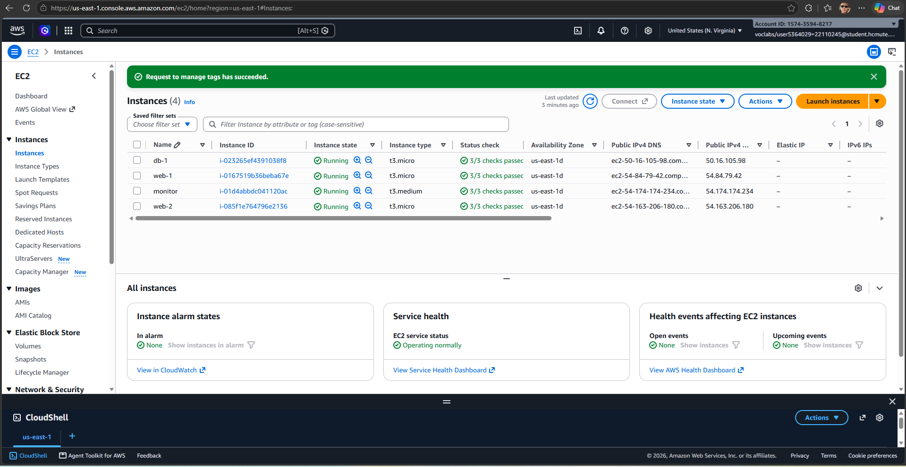

*Hình 2.1: Danh sách 4 EC2 đang chạy*

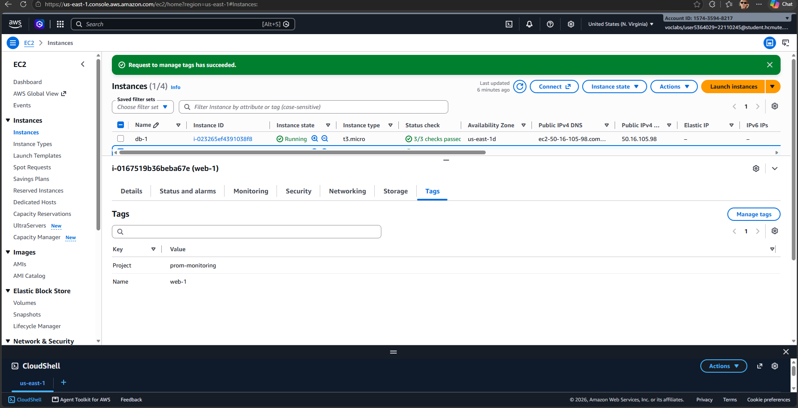

*Hình 2.2: IAM role và tag của web-1*

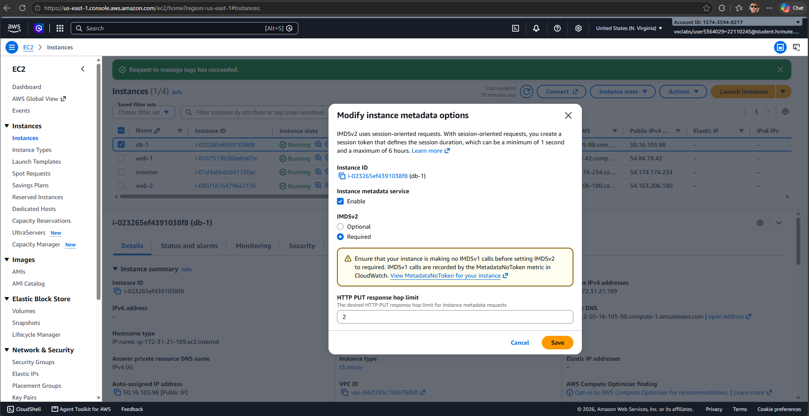

*Hình 2.3: Metadata options của máy monitor (HttpPutResponseHopLimit = 2)*

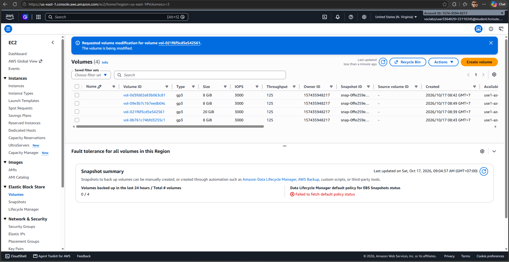

*Hình 2.4: EBS volumes*

## 3. Cài node_exporter trên 3 target

### 3.1 Tạo mật khẩu basic auth (trên máy cá nhân)

```bash
pip install -r requirements.txt
python hashpw.py node_exporter <mat-khau-exporter>
```

Kết quả dạng `node_exporter: $2b$12$...` (chuỗi bcrypt) dùng cho biến `BASIC_AUTH`. Dùng cùng một mật khẩu cho cả 3 target.

### 3.2 Cài đặt (trên từng máy web-1, web-2, db-1)

Kết nối SSH từ máy cá nhân bằng key `labsuser.pem`:

1. **Learner Lab → AWS Details → Download PEM**, lưu `labsuser.pem` vào thư mục `monitoring-lab`.
2. Lấy **Public IPv4** của từng máy tại **EC2 → Instances**.
3. Trên Windows (OpenSSH của PowerShell/CMD), giới hạn quyền file key một lần:
   ```powershell
   icacls labsuser.pem /inheritance:r /grant:r "${env:USERDOMAIN}\${env:USERNAME}:R"
   icacls labsuser.pem /remove:g "BUILTIN\Users" "BUILTIN\Administrators" "NT AUTHORITY\SYSTEM"
   ```
4. Chép script lên máy, SSH vào, chạy các lệnh cài đặt và kiểm tra bên dưới.
5. Lặp lại cho `web-2` và `db-1`.

> **Lưu ý:**
> - `sg-target` phải mở cổng **22** cho **My IP**. IP mạng nhà có thể đổi, khi SSH bị treo thì cập nhật lại rule này trước.
> - Lệnh `scp` phải có `:~` ở cuối, thiếu dấu `:` thì file chỉ được copy thành file cục bộ tên `ubuntu@<ip>`.
> - Chuỗi bcrypt phải nằm trong **nháy đơn** để shell không hiểu `$2b$12$` là biến.

```bash
scp -i labsuser.pem node_exporter/install.sh ubuntu@<public-ip>:~
ssh -i labsuser.pem ubuntu@<public-ip>
sudo BASIC_AUTH='node_exporter: $2b$12$...' bash install.sh
systemctl status node_exporter --no-pager
curl -s -u node_exporter:<mat-khau-exporter> localhost:9100/metrics | grep node_cpu_seconds_total | head -3
curl -s -o /dev/null -w "%{http_code}\n" localhost:9100/metrics
```

Script [`node_exporter/install.sh`](../../node_exporter/install.sh) tải bản phát hành đúng kiến trúc CPU (amd64/arm64), tạo `/etc/node_exporter/web-config.yml` chứa user bcrypt và đăng ký systemd service `node_exporter` chạy dưới user `nobody`. Lệnh curl không có mật khẩu trả về `401` chứng tỏ basic auth hoạt động.

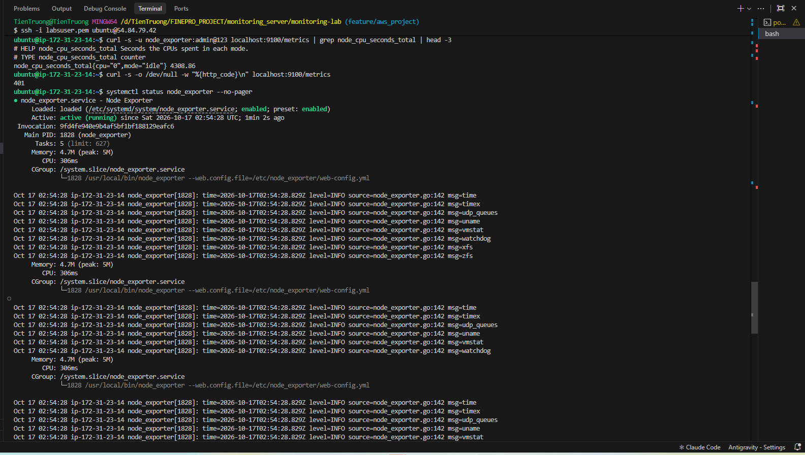

*Hình 2.5: node_exporter chạy và yêu cầu xác thực*

## 4. Triển khai stack giám sát trên EC2 monitor

### 4.1 Cài Docker và lấy mã nguồn

```bash
ssh -i labsuser.pem -o ServerAliveInterval=30 ubuntu@<public-ip-monitor>
sudo apt update && sudo apt install -y docker.io docker-compose-v2 git
sudo usermod -aG docker ubuntu && newgrp docker
git clone https://github.com/TienTruong71/monitoring_server.git monitoring-lab
cd monitoring-lab
git checkout feature/aws_project
```

> **Lưu ý:** Repo là private nên clone qua HTTPS với Username GitHub và Password là **Fine-grained personal access token** (quyền Contents: Read-only, chỉ cho repo này), tạo tại **GitHub → Settings → Developer settings → Personal access tokens**. `ServerAliveInterval=30` giữ phiên SSH không bị ngắt khi để lâu.

### 4.2 Tạo file bí mật (không commit lên Git)

| File | Nội dung |
|---|---|
| `secrets/exporter_pass` | Mật khẩu node_exporter (dạng thường, trùng với mục 3.1) |
| `secrets/prometheus_pass` | Mật khẩu user `admin` của Prometheus (dạng thường) |
| `secrets/slack_url` | Slack Incoming Webhook URL |
| `prometheus/web.yml` | `basic_auth_users:` + dòng `admin: <bcrypt>` sinh bằng `hashpw.py admin <mat-khau>` |
| `.env` | `GF_SECURITY_ADMIN_PASSWORD=...` và `PROM_WEB_PASS=<mat-khau-admin-prometheus>` |

Tạo trên máy monitor, trong `~/monitoring-lab`:

```bash
sudo apt install -y python3-bcrypt

EXPORTER_PASS='<mat-khau-exporter>'
PROM_PASS='<mat-khau-admin-prometheus>'
GRAFANA_PASS='<mat-khau-admin-grafana>'
SLACK_URL='<slack-webhook-url>'

mkdir -p secrets
printf '%s' "$EXPORTER_PASS" > secrets/exporter_pass
printf '%s' "$PROM_PASS"     > secrets/prometheus_pass
printf '%s' "$SLACK_URL"     > secrets/slack_url
{ echo "basic_auth_users:"; echo "  $(python3 hashpw.py admin "$PROM_PASS")"; } > prometheus/web.yml
printf 'GF_SECURITY_ADMIN_PASSWORD=%s\nPROM_WEB_PASS=%s\n' "$GRAFANA_PASS" "$PROM_PASS" > .env
```

Các đường dẫn trên đã nằm trong [`.gitignore`](../../.gitignore) nên không có sẵn sau khi clone và phải tạo lại trên server.

Các bước trên được gom vào [`scripts/setup_secrets.sh`](../../scripts/setup_secrets.sh): đặt 4 biến môi trường rồi chạy `./scripts/setup_secrets.sh`. Script dừng ngay nếu thiếu biến hoặc thiếu `python3-bcrypt`, và đặt quyền `600` cho `.env`.

### 4.3 Khởi chạy

```bash
docker compose up -d
docker compose ps
```

### 4.4 Giải thích cấu hình chính

**[`docker-compose.yml`](../../docker-compose.yml)**

| Service | Cổng | Ghi chú |
|---|---|---|
| prometheus | 9090 | Bật `--web.config.file` (basic auth) và `--web.enable-lifecycle` (reload qua API) |
| alertmanager | 127.0.0.1:9093 | Alertmanager không có xác thực nên chỉ bind localhost, truy cập qua SSH tunnel |
| grafana | 2404 → 3000 | Provision sẵn datasource và dashboard |

**[`prometheus/prometheus.yml`](../../prometheus/prometheus.yml) – job `node-aws`**

| Thành phần | Ý nghĩa |
|---|---|
| `ec2_sd_configs.region / port` | Gọi API EC2 ở us-east-1, scrape cổng 9100 |
| `filters tag:Monitoring=node` | Chỉ lấy instance có tag này → thêm/bớt máy không cần sửa cấu hình |
| `filters instance-state-name=running` | Bỏ qua máy đang stopped |
| `refresh_interval: 60s` | Cập nhật danh sách target mỗi phút |
| `relabel __meta_ec2_private_ip → __address__` | Scrape qua private IP (đi trong VPC, không ra Internet) |
| `relabel __meta_ec2_tag_Name → hostname` | Hiển thị tên máy dễ đọc trên Grafana/Slack |
| `relabel instance_id, instance_type, az, project, owner` | Gắn thêm ngữ cảnh AWS vào mọi metric |

**[`prometheus/rules/node_exporter.yml`](../../prometheus/rules/node_exporter.yml)**

| Alert | Điều kiện | `for` | Severity |
|---|---|---|---|
| NodeDown | `up == 0` | 1m | critical |
| HighCPUUsage | CPU > 80% | 5m | warning |
| HighRAMUsage | RAM > 90% | 5m | warning |
| HighDiskUsage | Dung lượng trống < 20% (bỏ qua tmpfs/overlay/squashfs) | 5m | warning |
| NetworkTrafficSpike | Inbound > 5× trung bình 1h và > 10 MB/s | 5m | critical |
| HighConnectionCount | TCP established > 5000 | 5m | warning |

**[`alertmanager/alertmanager.yml`](../../alertmanager/alertmanager.yml)**

| Thành phần | Ý nghĩa |
|---|---|
| `group_by: [alertname, instance]` | Gom cảnh báo cùng loại trên cùng máy thành 1 tin |
| `group_wait: 15s` | Chờ 15s gom các alert đến cùng lúc trước khi gửi lần đầu |
| `group_interval: 1m` | Khoảng cách gửi cập nhật cho một nhóm đã gửi |
| `repeat_interval: 4h` | Nhắc lại nếu alert vẫn còn sau 4 giờ |
| `routes severity=critical` | Critical → receiver `slack-critical` (màu đỏ) |
| `inhibit_rules` | Khi có critical thì chặn warning cùng `alertname` + `instance` |
| `send_resolved: true` | Gửi thông báo khi sự cố đã hết |

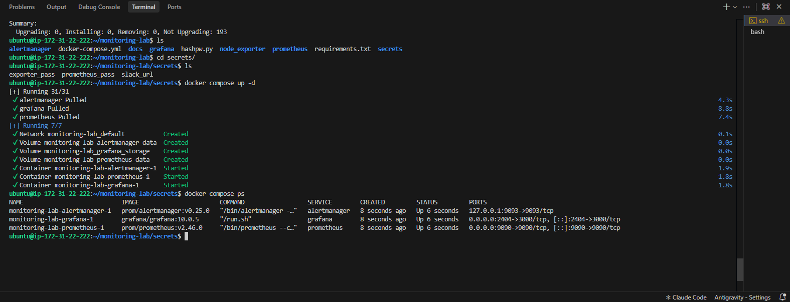

*Hình 2.6: Các container đang chạy*

## 5. Kiểm thử từng thành phần

### 5.1 Prometheus – service discovery và targets

Mở `http://<public-ip-monitor>:9090` (đăng nhập `admin`). `monitor-sg` phải mở 9090 và 2404 cho My IP.

> **Lưu ý:** Target mới phát hiện hiển thị **UNKNOWN** (Last Scrape: Never) trong khoảng 15 giây đầu, đây không phải lỗi. Nếu chuyển sang DOWN với `context deadline exceeded` thì `sg-target` chưa mở 9100 với Source là `monitor-sg`.

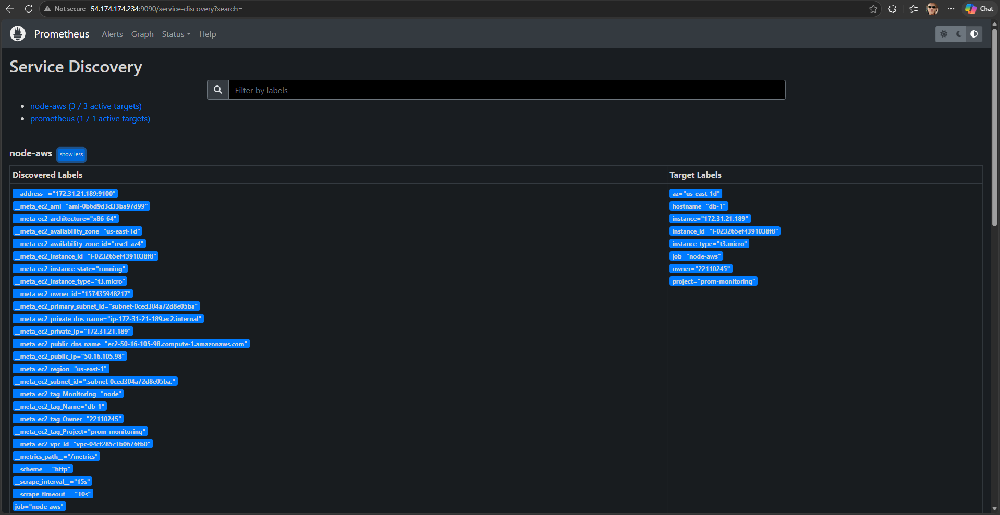

*Hình 2.7: Service Discovery của job node-aws*

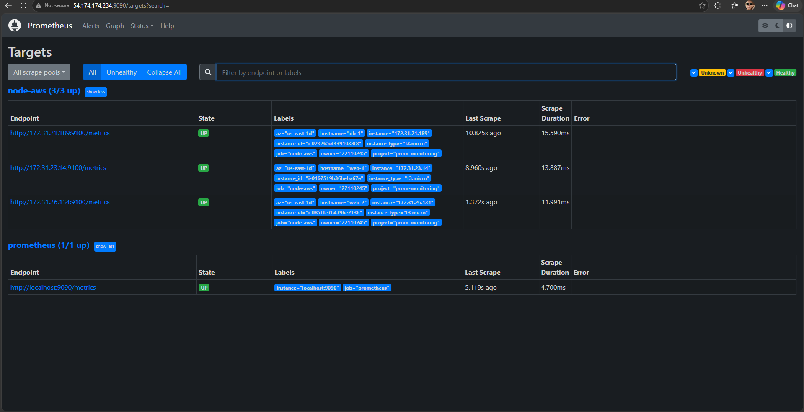

*Hình 2.8: Targets node-aws 3/3 UP*

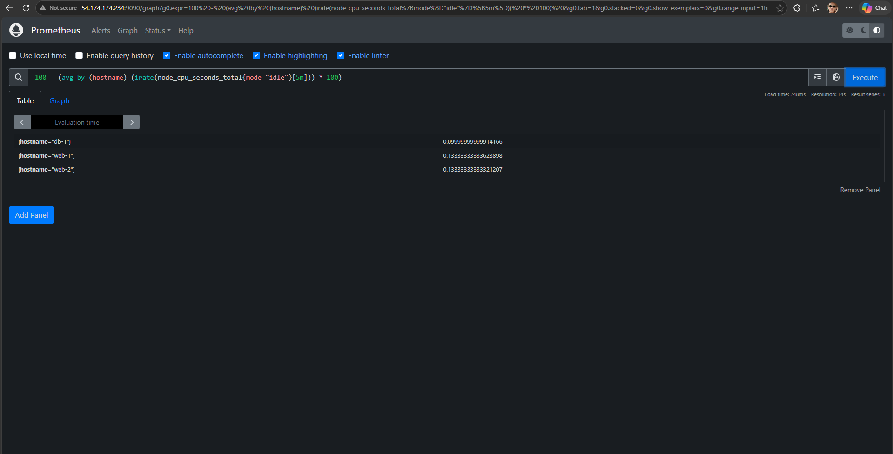

*Hình 2.9: Truy vấn PromQL*

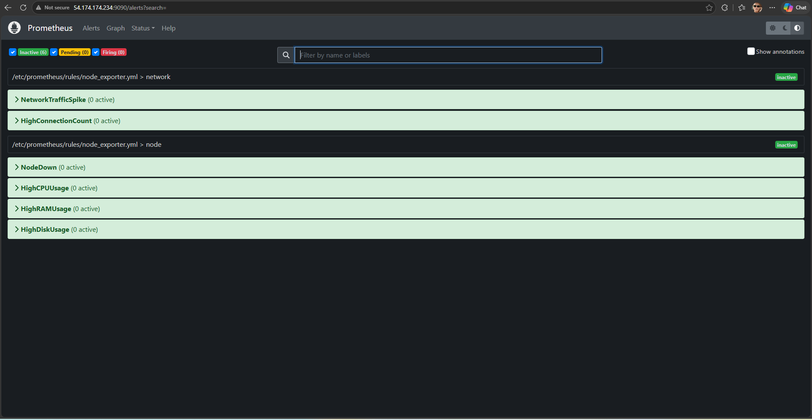

*Hình 2.10: 6 alert rule đã nạp*

### 5.2 Grafana – dashboard

Mở `http://<public-ip-monitor>:2404`, đăng nhập `admin` / mật khẩu trong `.env`.

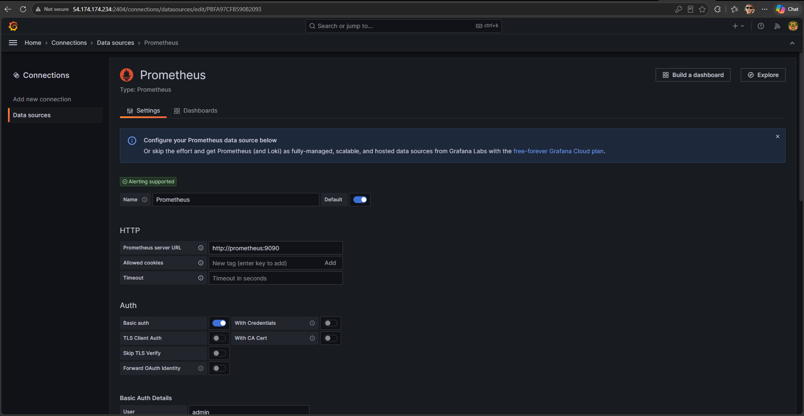

*Hình 2.11: Datasource Prometheus hoạt động*

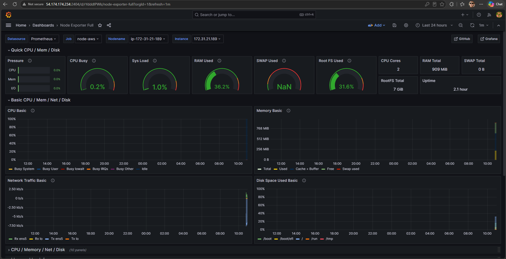

*Hình 2.12: Dashboard Node Exporter Full*

### 5.3 Alertmanager – gửi thử cảnh báo Slack

Trên máy monitor (mở tunnel để xem giao diện Alertmanager tại `http://localhost:9093` trên máy cá nhân):

```bash
ssh -i labsuser.pem -L 9093:localhost:9093 ubuntu@<public-ip-monitor>
cd ~/monitoring-lab
docker compose exec alertmanager amtool alert add TestAlert \
  severity=warning instance=test hostname=test \
  --annotation=summary="Test alert from Alertmanager" \
  --alertmanager.url=http://localhost:9093
```

Kiểm thử thật bằng cách dừng node_exporter trên **một máy target** (ví dụ web-1, không phải máy monitor), chờ khoảng 1 phút để `NodeDown` chuyển Firing, rồi bật lại:

```bash
ssh -i labsuser.pem ubuntu@<public-ip-web-1>
sudo systemctl stop node_exporter
sudo systemctl start node_exporter
```

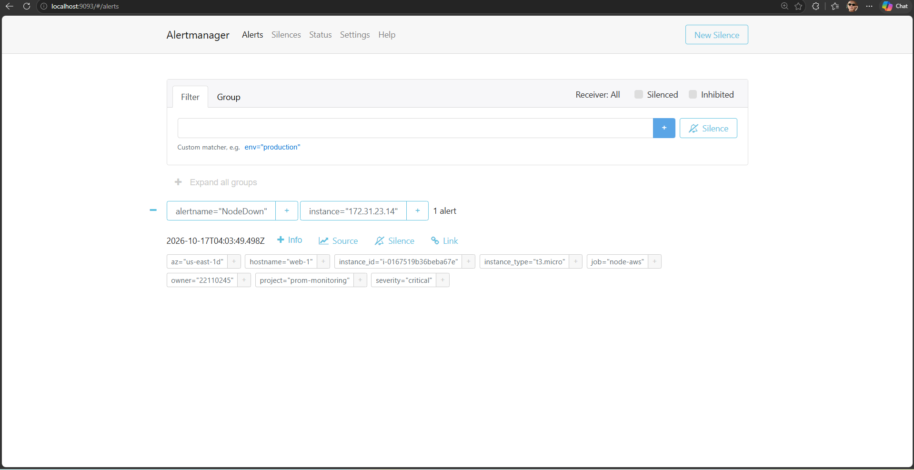

*Hình 2.13: Giao diện Alertmanager qua SSH tunnel*

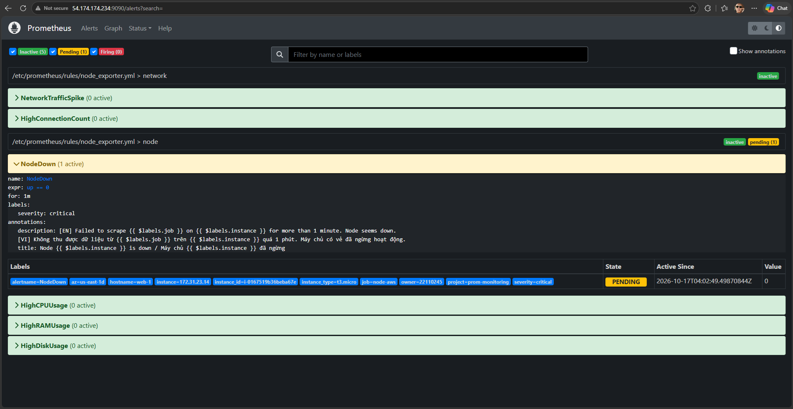

*Hình 2.14: NodeDown Firing trên Prometheus*

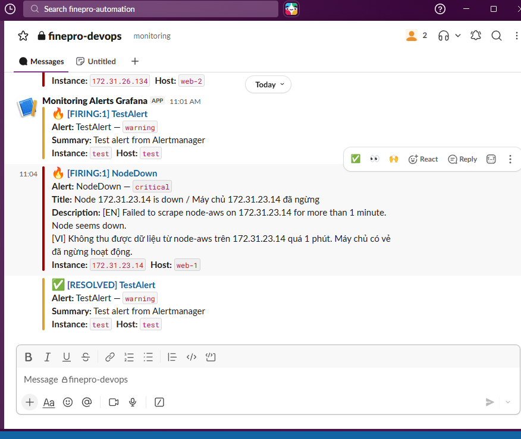

*Hình 2.15: Tin nhắn Slack FIRING và RESOLVED*

### 5.4 Kiểm tra bảo mật mạng

Từ máy cá nhân, thử truy cập trực tiếp node_exporter của target qua public IP (phải bị chặn bởi sg-target):

```bash
curl -m 5 http://<public-ip-web-1>:9100/metrics
```

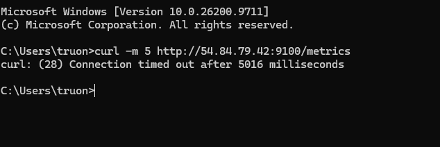

*Hình 2.16: Truy cập 9100 từ Internet bị chặn*

Có thể chạy lại cả 3 bước kiểm thử (PromQL `up{job="node-aws"}`, health check datasource Grafana, chặn cổng 9100) bằng [`scripts/verify_stack.sh`](../../scripts/verify_stack.sh) từ máy cá nhân:

```bash
PROM_PASS='<mat-khau-admin-prometheus>' GRAFANA_PASS='<mat-khau-admin-grafana>' \
  ./scripts/verify_stack.sh <public-ip-monitor> <public-ip-web-1> <public-ip-web-2> <public-ip-db-1>
```

## 6. Kết quả tuần 2

| Hạng mục | Kết quả |
|---|---|
| 4 EC2 running, gắn LabInstanceProfile, đúng tag | ☑ |
| node_exporter có basic auth trên 3 target | ☑ |
| Stack Docker chạy ổn định | ☑ |
| Service discovery tìm thấy 3 target, tất cả UP | ☑ |
| Dashboard Grafana hiển thị đủ 3 máy | ☑ |
| Cảnh báo NodeDown gửi Slack (firing + resolved) | ☑ |
| Port 9100 không truy cập được từ Internet | ☑ |

## 7. Khó khăn và cách giải quyết

| Khó khăn | Nguyên nhân | Cách giải quyết |
|---|---|---|
| EC2 Instance Connect báo *Error establishing SSH connection* | `sg-target` chỉ mở 22 cho My IP, trong khi Instance Connect kết nối từ dải IP của AWS (`18.206.107.24/29`) | Chuyển sang SSH từ máy cá nhân bằng `labsuser.pem` |
| `scp` chạy xong nhưng trên EC2 không có `install.sh` | Thiếu `:~` sau địa chỉ, `scp` copy thành file cục bộ tên `ubuntu@<ip>` | Thêm `:~` vào đích, xóa file cục bộ thừa |
| SSH treo, không phản hồi | IP public của mạng nhà đã đổi, không còn khớp rule 22 | Cập nhật Source rule SSH về **My IP** |
| PowerShell báo *UNPROTECTED PRIVATE KEY FILE* | OpenSSH trên Windows từ chối key khi nhóm khác (`BUILTIN\Users`) có quyền đọc; Git Bash không kiểm tra nên trước đó vẫn chạy | Dùng `icacls` gỡ kế thừa và quyền của các nhóm khác, chỉ giữ user hiện tại |
| `git clone git@github.com:...` báo *Permission denied (publickey)* | Repo private, máy monitor chưa có SSH key được GitHub chấp nhận | Clone qua HTTPS bằng Fine-grained personal access token (read-only) |
| Job `node-aws` không xuất hiện, log báo `NoCredentialProviders` | Máy monitor chưa gắn `LabInstanceProfile`, hop limit IMDS = 1 nên container không lấy được credentials | Gắn IAM role cho monitor và đặt `http-put-response-hop-limit 2` |
| Hết lỗi credentials nhưng vẫn không có target | 3 máy target chưa có tag `Monitoring=node` (db-1 thiếu cả `Project`) | Gắn tag bằng `aws ec2 create-tags` trong CloudShell |
| Target DOWN sau khi được phát hiện | `sg-target` chưa cho cổng 9100 từ máy monitor | Thêm rule 9100 với Source là Security Group `monitor-sg`; xóa rule 2404 thừa trên `sg-target` |
| Không mở được Grafana | Gõ nhầm cổng 2024; rule 2404 trên `monitor-sg` còn IP cũ | Dùng đúng cổng 2404, cập nhật rule về My IP |
| `docker compose exec` báo *no configuration file provided*; `systemctl stop node_exporter` báo *Unit not found* | Chạy lệnh ngoài thư mục chứa `docker-compose.yml`; dừng node_exporter nhầm trên máy monitor | `cd ~/monitoring-lab` trước khi chạy compose; SSH vào máy target để thử NodeDown |

## 8. Nhật ký công việc (Worklog)

| Ngày | Thành viên | Công việc | Số giờ |
|---|---|---|---|
| ……/…… | Trương Thành Tiến | Tạo 4 EC2, kiểm tra EBS và giới hạn Learner Lab | 2 |
| ……/…… | Lê Nguyễn Thiên Phúc | Cấu hình Security Group (`monitor-sg`, `sg-target`), xử lý lỗi SSH/Instance Connect và quyền file key | 2 |
| ……/…… | Trương Thành Tiến | Tạo bcrypt, cài node_exporter + basic auth trên web-1, web-2, db-1 | 2 |
| ……/…… | Lê Nguyễn Thiên Phúc | Cài Docker, clone repo bằng PAT, tạo secrets / `web.yml` / `.env`, chạy stack | 2.5 |
| ……/…… | Trương Thành Tiến | Gắn LabInstanceProfile, đặt IMDS hop limit, gắn tag `Monitoring/Project/Owner`, kiểm tra Service Discovery và Targets | 2.5 |
| ……/…… | Lê Nguyễn Thiên Phúc | Kiểm thử Grafana datasource/dashboard, PromQL, kiểm tra port 9100 bị chặn | 2 |
| ……/…… | Trương Thành Tiến | Kiểm thử Alertmanager (amtool, SSH tunnel), NodeDown → Slack firing/resolved | 1.5 |
| ……/…… | Lê Nguyễn Thiên Phúc | Chụp minh chứng, tổng hợp khó khăn, viết báo cáo tuần 2 | 1.5 |
| | | **Tổng Trương Thành Tiến** | **8** |
| | | **Tổng Lê Nguyễn Thiên Phúc** | **8** |

## 9. Kế hoạch tuần 3

- Bật Detailed Monitoring, cài CloudWatch Agent (RAM/Disk) trên 3 target.
- Tạo CloudWatch Dashboard, Alarm + SNS email.
- Thêm datasource CloudWatch trên Grafana.
- Kiểm thử tải bằng `stress-ng`, đo độ trễ cảnh báo của hai hệ thống.
- Viết IaC (CloudFormation) để dựng lại hạ tầng.
