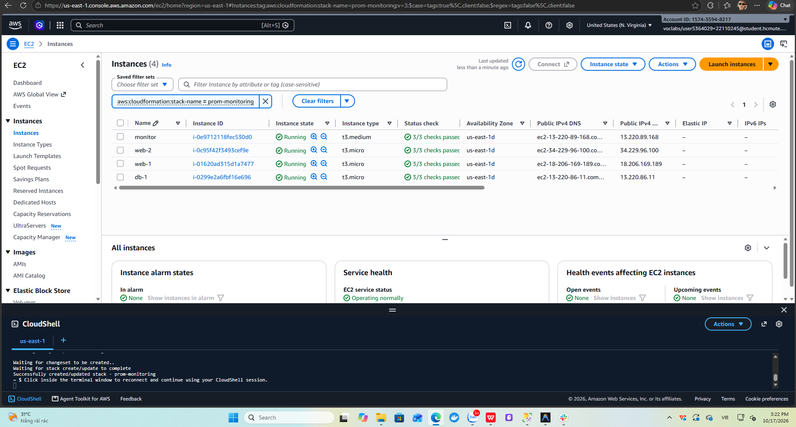
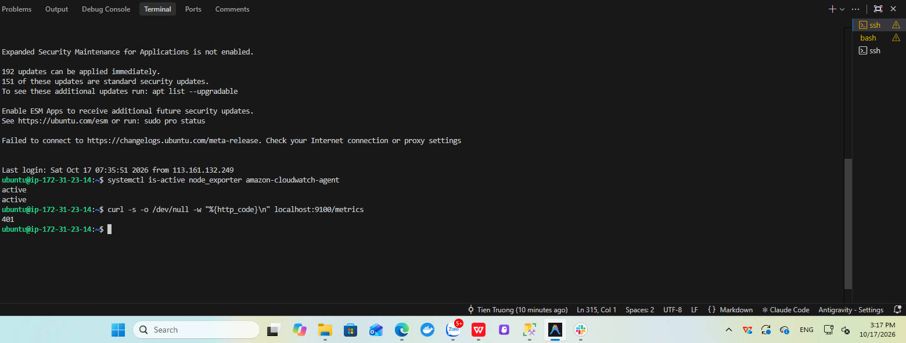
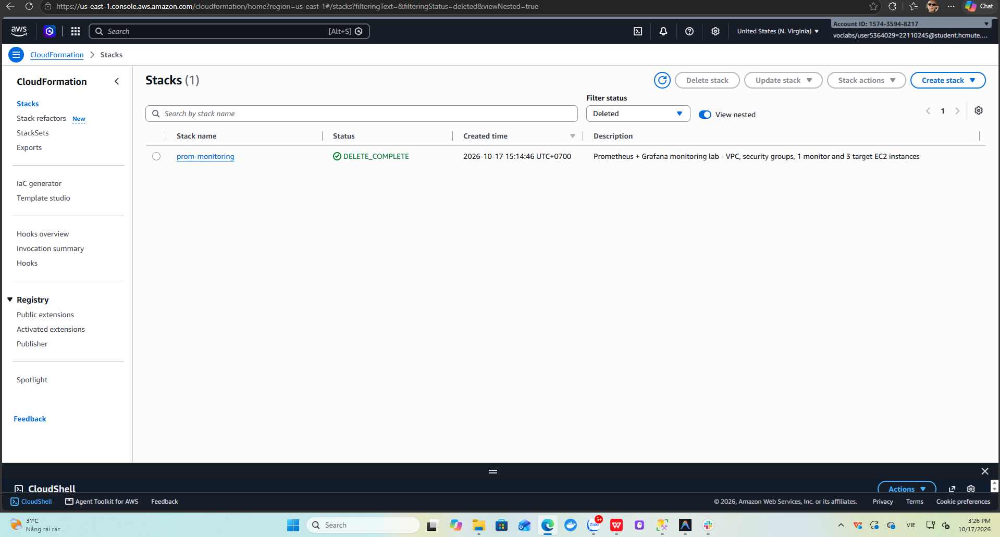

# Báo cáo Tuần 3 – Tích hợp, bảo mật, giám sát CloudWatch, tự động hóa

**Đề tài:** Hệ thống giám sát mã nguồn mở Prometheus + Grafana trên AWS (Nhóm: Infrastructure)
**Thời gian:** ……/……/2026 – ……/……/2026
**Thành viên:** Trương Thành Tiến – MSSV 22110245 · Lê Nguyễn Thiên Phúc – MSSV ………
**Region:** us-east-1 · **Account ID:** 1574-3594-8217

---

## 1. Mục tiêu tuần

- Triển khai giám sát song song bằng Amazon CloudWatch để có cơ sở so sánh với Prometheus.
- Cài CloudWatch Agent thu RAM/Disk; tạo Dashboard, Alarm và SNS email.
- Tích hợp datasource CloudWatch vào Grafana.
- Chạy kịch bản tải, đo độ trễ cảnh báo của hai hệ thống.
- Rà soát bảo mật; tự động hóa hạ tầng bằng CloudFormation.

## 2. CloudWatch – metric mặc định và Detailed Monitoring

Mặc định EC2 chỉ gửi metric lên CloudWatch 5 phút một lần (Basic Monitoring). Bật Detailed Monitoring để giảm chu kỳ xuống **1 phút**, cùng độ phân giải với alarm ở mục 5.

Trên console: **EC2 → Instances → tick một instance → Actions → Monitor and troubleshoot → Manage detailed monitoring → Enable → Confirm**, lặp lại cho web-2 và db-1. Hoặc bật cả 3 máy trong CloudShell:

```bash
aws ec2 monitor-instances --instance-ids i-0167519b36beba67e i-085f1e764796e2136 i-023265ef4391038f8
aws ec2 describe-instances --instance-ids i-0167519b36beba67e i-085f1e764796e2136 i-023265ef4391038f8 \
  --query "Reservations[].Instances[].[Tags[?Key=='Name']|[0].Value,Monitoring.State]" --output table
```

> **Lưu ý:** Mục *Manage detailed monitoring* bị mờ khi chọn nhiều instance cùng lúc, chỉ bấm được khi chọn đúng một instance.


*Hình 3.1: Tab Monitoring của web-1*

Metric mặc định của EC2 chỉ có CPU, Network, Disk I/O (instance store) và Status Check, **không có** RAM và dung lượng ổ đĩa vì hypervisor không nhìn được vào bên trong hệ điều hành.


*Hình 3.2: Metric mặc định của EC2, không có memory / disk used*

## 3. CloudWatch Agent (RAM, Disk)

### 3.1 Cài đặt trên 3 target

SSH vào từng máy web-1, web-2, db-1 và chạy:

```bash
wget https://s3.amazonaws.com/amazoncloudwatch-agent/ubuntu/amd64/latest/amazon-cloudwatch-agent.deb
sudo dpkg -i amazon-cloudwatch-agent.deb
sudo nano /opt/aws/amazon-cloudwatch-agent/bin/config.json
```

Các bước 3.1–3.2 được gom vào [`scripts/install_cw_agent.sh`](../../scripts/install_cw_agent.sh): script kiểm tra IAM role qua IMDS trước khi cài, ghi `config.json` và chạy `fetch-config` trên một dòng.

```bash
scp -i labsuser.pem scripts/install_cw_agent.sh ubuntu@<public-ip-target>:~
ssh -i labsuser.pem ubuntu@<public-ip-target> sudo ./install_cw_agent.sh
```

### 3.2 Cấu hình `/opt/aws/amazon-cloudwatch-agent/bin/config.json`

```json
{
  "agent": { "metrics_collection_interval": 60, "run_as_user": "root" },
  "metrics": {
    "namespace": "CWAgent",
    "append_dimensions": { "InstanceId": "${aws:InstanceId}" },
    "metrics_collected": {
      "mem":  { "measurement": ["mem_used_percent"] },
      "disk": { "measurement": ["used_percent"], "resources": ["/"], "ignore_file_system_types": ["tmpfs", "overlay", "squashfs"] },
      "cpu":  { "measurement": ["cpu_usage_idle"], "totalcpu": true }
    }
  }
}
```

Biến `${aws:InstanceId}` được agent tự thay bằng ID của từng máy nên cả 3 target dùng chung một file cấu hình.

```bash
sudo /opt/aws/amazon-cloudwatch-agent/bin/amazon-cloudwatch-agent-ctl -a fetch-config -m ec2 -s -c file:/opt/aws/amazon-cloudwatch-agent/bin/config.json
sudo /opt/aws/amazon-cloudwatch-agent/bin/amazon-cloudwatch-agent-ctl -a status
```

Agent dùng quyền `cloudwatch:PutMetricData` của LabInstanceProfile, không cần access key.

> **Lưu ý:**
> - Lệnh `fetch-config` phải dán trên **một dòng**. Khi dán lệnh nhiều dòng có `\`, terminal tách thành lệnh riêng và báo `-a: command not found`, agent vẫn ở trạng thái `not configured`.
> - Máy chưa gắn IAM role thì agent vẫn `running` nhưng log báo `no EC2 IMDS role found` và không có metric. Kiểm tra bằng:
>   ```bash
>   aws ec2 describe-instances --query "Reservations[].Instances[].[Tags[?Key=='Name']|[0].Value,PrivateIpAddress,IamInstanceProfile.Arn]" --output table
>   aws ec2 associate-iam-instance-profile --instance-id <instance-id> --iam-instance-profile Name=LabInstanceProfile
>   sudo systemctl restart amazon-cloudwatch-agent
>   ```


*Hình 3.3: CloudWatch Agent đang chạy*


*Hình 3.4: Custom metric `mem_used_percent` trong namespace CWAgent*

## 4. CloudWatch Dashboard

Dashboard `prom-monitoring-compare` gồm 5 widget dạng Line:

| Widget | Namespace / Metric | Period |
|---|---|---|
| CPU Utilization | AWS/EC2 · CPUUtilization (3 instance) | 1 phút |
| Memory Used % | CWAgent · mem_used_percent | 1 phút |
| Disk Used % (/) | CWAgent · disk_used_percent (truy vấn `SEARCH` theo `path="/"`) | 1 phút |
| Network In/Out | AWS/EC2 · NetworkIn, NetworkOut | 1 phút |
| Status Check | AWS/EC2 · StatusCheckFailed (Maximum) | 1 phút |

Dashboard được tạo bằng một lệnh trong CloudShell từ file định nghĩa JSON `dash.json` (mảng `widgets` theo bảng trên):

```bash
aws cloudwatch put-dashboard --dashboard-name prom-monitoring-compare --dashboard-body file://dash.json
```

Kết quả `"DashboardValidationMessages": []` nghĩa là dashboard hợp lệ.


*Hình 3.5: CloudWatch Dashboard prom-monitoring-compare*

## 5. CloudWatch Alarm + SNS

### 5.1 SNS

1. **SNS → Topics → Create topic** · Standard · tên `prom-monitoring-alerts` · tag `Project`, `Owner`.
2. **Create subscription** · Protocol **Email** · nhập email → mở mail bấm **Confirm subscription**.


*Hình 3.6: SNS subscription đã xác nhận*

### 5.2 Alarm tương ứng với rule Prometheus

| Alarm | Metric | Điều kiện | Datapoints | Tương ứng rule Prometheus |
|---|---|---|---|---|
| `<máy>-HighCPU` (×3) | AWS/EC2 CPUUtilization | > 80 | 5 / 5 (period 1 phút) | HighCPUUsage |
| `<máy>-HighRAM` (×3) | CWAgent mem_used_percent | > 90 | 5 / 5 | HighRAMUsage |
| `<máy>-StatusCheck` (×3) | AWS/EC2 StatusCheckFailed | ≥ 1 | 1 / 1 | NodeDown (mức hạ tầng) |

Action **In alarm** và **OK** đều gửi về topic `prom-monitoring-alerts`. 9 alarm được tạo bằng vòng lặp trong CloudShell:

```bash
TOPIC=$(aws sns list-topics --query "Topics[?ends_with(TopicArn,':prom-monitoring-alerts')].TopicArn" --output text)
for P in web-1:i-0167519b36beba67e web-2:i-085f1e764796e2136 db-1:i-023265ef4391038f8; do
  N=${P%%:*}; ID=${P#*:}
  aws cloudwatch put-metric-alarm --alarm-name "$N-HighCPU" \
    --namespace AWS/EC2 --metric-name CPUUtilization --dimensions Name=InstanceId,Value=$ID \
    --statistic Average --period 60 --evaluation-periods 5 --datapoints-to-alarm 5 \
    --threshold 80 --comparison-operator GreaterThanThreshold \
    --alarm-actions "$TOPIC" --ok-actions "$TOPIC"
  aws cloudwatch put-metric-alarm --alarm-name "$N-HighRAM" \
    --namespace CWAgent --metric-name mem_used_percent --dimensions Name=InstanceId,Value=$ID \
    --statistic Average --period 60 --evaluation-periods 5 --datapoints-to-alarm 5 \
    --threshold 90 --comparison-operator GreaterThanThreshold \
    --alarm-actions "$TOPIC" --ok-actions "$TOPIC"
  aws cloudwatch put-metric-alarm --alarm-name "$N-StatusCheck" \
    --namespace AWS/EC2 --metric-name StatusCheckFailed --dimensions Name=InstanceId,Value=$ID \
    --statistic Maximum --period 60 --evaluation-periods 1 --datapoints-to-alarm 1 \
    --threshold 1 --comparison-operator GreaterThanOrEqualToThreshold \
    --alarm-actions "$TOPIC" --ok-actions "$TOPIC"
done
```


*Hình 3.7: 9 CloudWatch Alarm ở trạng thái OK*

## 6. Tích hợp CloudWatch vào Grafana

Datasource `CloudWatch` được provision sẵn trong [`grafana/provisioning/datasources/datasource.yml`](../../grafana/provisioning/datasources/datasource.yml) với `authType: default` (dùng credentials của LabInstanceProfile qua IMDS) và `defaultRegion: us-east-1`. Grafana chạy trong Docker nên máy monitor cần hop limit IMDS = 2 (đã đặt ở mục 2.2 tuần 2).

```bash
cd ~/monitoring-lab
git pull
docker compose restart grafana
```

Dashboard `Prometheus vs CloudWatch` được import bằng JSON (**Dashboards → New → Import**), gồm 2 panel CPU của web-1 đặt cạnh nhau, time range 30 phút, tự refresh 10 giây:

| Panel | Datasource | Truy vấn |
|---|---|---|
| CPU web-1 – Prometheus (15s) | Prometheus | `100 - (avg by (hostname) (irate(node_cpu_seconds_total{mode="idle", hostname="web-1"}[1m])) * 100)` |
| CPU web-1 – CloudWatch (1m) | CloudWatch | Namespace `AWS/EC2`, Metric `CPUUtilization`, Dimension `InstanceId = i-0167519b36beba67e`, Statistic Average, Period 60 |


*Hình 3.8: Datasource CloudWatch hoạt động*


*Hình 3.9: Dashboard so sánh CPU web-1 giữa Prometheus và CloudWatch trong lúc chạy stress*

## 7. Kiểm thử tải và đo độ trễ cảnh báo

### 7.1 Kịch bản

Cài công cụ trên các target:

```bash
sudo apt update && sudo apt install -y stress-ng htop
```

| Kịch bản | Máy | Lệnh |
|---|---|---|
| CPU 100% | web-1 | `TZ=Asia/Ho_Chi_Minh date '+%H:%M:%S'; stress-ng --cpu 2 --timeout 600s` |
| RAM > 90% | web-2 | `TZ=Asia/Ho_Chi_Minh date '+%H:%M:%S'; stress-ng --vm 1 --vm-bytes 92% --vm-keep --timeout 600s` |
| Dừng node_exporter | db-1 | `TZ=Asia/Ho_Chi_Minh date '+%H:%M:%S'; sudo systemctl stop node_exporter` |

> **Lưu ý:** Ubuntu trên EC2 dùng giờ UTC còn Slack và Gmail hiển thị giờ Việt Nam, nên in giờ bắt đầu với `TZ=Asia/Ho_Chi_Minh` để so sánh cùng múi giờ. Nếu dòng `date` bị trôi khỏi màn hình, lấy lại giờ bắt đầu thật của tiến trình bằng `ps -o lstart= -p $(pgrep -o stress-ng)`.

### 7.2 Kết quả đo

| Kịch bản | Máy | Bắt đầu | Slack (Prometheus) | Email (CloudWatch) | Độ trễ Prometheus | Độ trễ CloudWatch |
|---|---|---|---|---|---|---|
| CPU 100% | web-1 | 14:37:22 | 14:43 | 14:44:07 | ≈ 5 phút 40 giây | ≈ 6 phút 45 giây |
| RAM > 90% | web-2 | ..:..:.. | ..:..:.. | ..:..:.. | … | … |
| Dừng node_exporter | db-1 | ..:..:.. | 14:55 | *không báo* | … | – |
| Hết sự cố (resolved / OK) | web-1 | 14:47:22 | ..:..:.. | ..:..:.. | … | … |

Phân tích kịch bản CPU:

- **Prometheus:** alert `HighCPUUsage` chuyển *pending* lúc 14:37:49, chỉ 27 giây sau khi bắt đầu stress, vì `irate` chỉ dùng 2 mẫu cuối (scrape 15 giây). Sau `for: 5m` alert chuyển *firing* lúc khoảng 14:42:49, cộng `group_wait` 15 giây nên tin Slack đến lúc 14:43. Độ trễ ≈ thời gian phát hiện + `for` + `group_wait`.
- **CloudWatch:** alarm cần 5/5 datapoint 1 phút vượt 80% (07:39 → 07:43 UTC). Alarm chuyển ALARM lúc 07:44:07 UTC (14:44:07), chậm hơn Prometheus khoảng 1 phút do datapoint 1 phút chỉ có sau khi phút đó kết thúc và mất thêm thời gian để metric được đẩy lên.
- **Dừng node_exporter:** Prometheus phát hiện được (`up == 0`) vì giám sát ở **mức dịch vụ**; alarm `db-1-StatusCheck` vẫn OK vì máy ảo vẫn chạy, nghĩa là CloudWatch chỉ giám sát ở **mức hạ tầng**.


*Hình 3.10: stress-ng chạy trên web-1, CPU 100%*


*Hình 3.11: Slack nhận HighCPUUsage của web-1 lúc 14:43*


*Hình 3.12: Alarm web-1-HighCPU chuyển In alarm*


*Hình 3.13: Email SNS "ALARM: web-1-HighCPU" lúc 14:44*


*Hình 3.14: Slack nhận HighRAMUsage của web-2*


*Hình 3.15: Slack báo NodeDown db-1 trong khi alarm db-1-StatusCheck vẫn OK*

## 8. Bảo mật

| Lớp | Biện pháp | Minh chứng |
|---|---|---|
| Mạng | Port 9100 chỉ mở cho sg-monitor; 22/2404/9090 chỉ mở cho IP cá nhân `/32` | Hình 1.6, 1.7, 2.16 |
| Mạng | Prometheus scrape qua private IP trong VPC | Hình 2.8 |
| Xác thực | node_exporter và Prometheus dùng basic auth (bcrypt) | Hình 2.5 |
| Xác thực | Grafana đổi mật khẩu admin qua `.env` | – |
| Bề mặt tấn công | Alertmanager bind `127.0.0.1`, chỉ vào được qua SSH tunnel | Hình 2.6, 2.13 |
| IAM | Chỉ dùng LabInstanceProfile, không có access key trên máy | Hình 2.2 |
| Bí mật | `secrets/`, `.env`, `web.yml` nằm trong `.gitignore`, không có trên Git | Hình 3.16 |
| Dữ liệu | EBS gp3, S3 chặn public access, bật versioning | Hình 1.8 |


*Hình 3.16: Repo trên GitHub không chứa secrets/, .env, prometheus/web.yml*

## 9. Tự động hóa hạ tầng bằng CloudFormation (IaC)

Tuần 1–3, hạ tầng được tạo thủ công trên console nên mất nhiều thời gian và dễ sai sót (quên tag `Monitoring=node`, quên gắn IAM role, quên hop limit 2). Template [`infra/stack.yml`](../../infra/stack.yml) mô tả lại toàn bộ hạ tầng đó dưới dạng mã. Chỉ cần một lệnh để dựng lại từ đầu và một lệnh để xóa sạch sau buổi lab.

### 9.1 Nội dung template

| Nhóm | Tài nguyên | Ghi chú |
|---|---|---|
| Mạng | VPC `10.20.0.0/16`, public subnet `10.20.1.0/24`, Internet Gateway, route table | Tách riêng khỏi VPC mặc định |
| Bảo mật | `prom-monitor-sg`: 22, 2404, 9090 chỉ từ `MyIp` | Giống `monitor-sg` |
| | `prom-target-sg`: 22 từ `MyIp`; 9100 chỉ từ `prom-monitor-sg` | Giống `sg-target` |
| Launch template | Monitor: t3.medium, 20 GB gp3, IMDSv2 bắt buộc, **hop limit 2** | User data cài Docker, Compose, Git |
| | Target: t3.micro, 8 GB gp3, Detailed Monitoring theo tham số | User data cài node_exporter có basic auth, CloudWatch Agent (cấu hình giống mục 3.2), stress-ng |
| EC2 | `monitor`, `web-1`, `web-2`, `db-1` | Đều gắn `LabInstanceProfile`, tag `Project`, `Owner`; 3 target có tag `Monitoring` |
| Outputs | Public IP, URL Grafana/Prometheus, instance ID 3 target | Dùng cho bước kiểm tra |

| Tham số | Mặc định | Ý nghĩa |
|---|---|---|
| `MyIp` | (bắt buộc) | IP cá nhân dạng `x.x.x.x/32` |
| `ExporterBasicAuth` | (bắt buộc, ẩn) | Chuỗi `node_exporter: $2b$12$...` sinh từ `hashpw.py` (mục 3.1 tuần 2) |
| `Owner` | `22110245` | Tag Owner |
| `KeyName` | `vockey` | Key pair của Learner Lab |
| `MonitoringTag` | `node` | Giá trị tag mà `ec2_sd_configs` lọc |
| `DetailedMonitoring` | `false` | `true` để bật chu kỳ 1 phút |
| `UbuntuAmi` | SSM `ubuntu/server/24.04/.../ami-id` | Luôn lấy AMI Ubuntu mới nhất, không cần sửa ID |

Template đã được kiểm tra cú pháp bằng `cfn-lint` (không có lỗi).

### 9.2 Triển khai

> **Lưu ý:** Khi hệ thống thủ công vẫn đang chạy, Prometheus cũ cũng lọc tag `Monitoring=node` trong cùng region. Nếu giữ mặc định, nó sẽ phát hiện 3 target mới nhưng không scrape được (khác VPC) và bắn `NodeDown` lên Slack. Vì vậy khi chỉ triển khai để minh chứng, đặt `MonitoringTag=node-iac`.

1. Mở **CloudShell → Actions → Upload file**, chọn `infra/stack.yml`.
2. Kiểm tra template trên AWS:
   ```bash
   aws cloudformation validate-template --template-body file://stack.yml
   ```
3. Triển khai (chuỗi bcrypt để trong **nháy đơn**):
   ```bash
   aws cloudformation deploy \
     --template-file stack.yml \
     --stack-name prom-monitoring \
     --parameter-overrides \
       MyIp=<ip-ca-nhan>/32 \
       'ExporterBasicAuth=node_exporter: $2b$12$...' \
       MonitoringTag=node-iac \
     --tags Project=prom-monitoring Owner=22110245
   ```
   Lệnh chờ đến khi stack ở trạng thái `CREATE_COMPLETE` (khoảng 3–4 phút).
4. Xem output:
   ```bash
   aws cloudformation describe-stacks --stack-name prom-monitoring --query "Stacks[0].Outputs" --output table
   ```
5. Kiểm tra user data đã chạy xong trên một target (đợi thêm 2–3 phút sau khi stack xong):
   ```bash
   ssh -i labsuser.pem ubuntu@<Web1PublicIp>
   systemctl is-active node_exporter amazon-cloudwatch-agent
   curl -s -o /dev/null -w "%{http_code}\n" localhost:9100/metrics
   ```
   Kết quả: hai dòng `active` và mã `401` (basic auth hoạt động).
6. Trên máy `monitor` mới: clone repo, tạo `secrets/`, `.env`, `prometheus/web.yml` và chạy `docker compose up -d` như mục 4 tuần 2. Docker đã được user data cài sẵn. Nếu dùng `MonitoringTag=node-iac` thì sửa filter `tag:Monitoring` trong `prometheus/prometheus.yml` thành `node-iac`.


*Hình 3.17: Stack prom-monitoring CREATE_COMPLETE và danh sách tài nguyên*



*Hình 3.18: 4 EC2 do stack tạo*



*Hình 3.19: Dịch vụ node_exporter và CloudWatch Agent active, node_exporter trả 401 khi không có mật khẩu*

### 9.3 Dọn dẹp

```bash
aws cloudformation delete-stack --stack-name prom-monitoring
aws cloudformation wait stack-delete-complete --stack-name prom-monitoring
```

Xóa stack sẽ xóa toàn bộ tài nguyên đã tạo (EC2, EBS, SG, VPC), tránh tốn credit Learner Lab. Các alarm và dashboard CloudWatch tạo ở mục 4–5 không nằm trong stack nên không bị ảnh hưởng.



*Hình 3.20: Stack prom-monitoring DELETE_COMPLETE*

## 10. Kết quả tuần 3

| Hạng mục | Kết quả |
|---|---|
| Detailed Monitoring cho 3 target (datapoint 1 phút) | ☑ |
| CloudWatch Agent gửi RAM/Disk từ 3 target | ☑ |
| CloudWatch Dashboard 5 widget | ☑ |
| 9 Alarm + SNS email hoạt động | ☑ |
| Grafana đọc được CloudWatch, dashboard so sánh | ☑ |
| Đo độ trễ cảnh báo các kịch bản | ☐ |
| Rà soát bảo mật | ☑ |
| IaC CloudFormation (tạo và xóa stack) | ☑ |

## 11. Khó khăn và cách giải quyết

| Khó khăn | Nguyên nhân | Cách giải quyết |
|---|---|---|
| Mục *Manage detailed monitoring* bị mờ | Chọn 3 instance cùng lúc, mục này chỉ áp dụng cho một instance | Chọn từng instance, hoặc dùng `aws ec2 monitor-instances` cho cả 3 máy |
| `amazon-cloudwatch-agent-ctl` báo `-a: command not found`, agent `not configured` | Dán lệnh nhiều dòng có `\` vào terminal bị tách thành các lệnh riêng | Chạy `fetch-config` trên một dòng |
| Namespace CWAgent chỉ có metric của db-1 | web-1, web-2 chưa gắn IAM role, log agent báo `no EC2 IMDS role found` (404) | Gắn `LabInstanceProfile` bằng `associate-iam-instance-profile`, restart agent |
| Tạo 5 widget và 9 alarm bằng tay mất thời gian, dễ nhầm instance | Mỗi alarm phải chọn metric, dimension, ngưỡng, action riêng | Dùng `put-dashboard` với file JSON và vòng lặp `put-metric-alarm` trong CloudShell |
| Sau 4 phút chạy stress vẫn chưa có tin Slack | Rule `HighCPUUsage` có `for: 5m`, alert đang ở trạng thái pending | Kiểm tra trạng thái qua API `/api/v1/alerts` của Prometheus, đợi đủ 5 phút |
| Gauge CPU Busy trên Grafana chỉ hiện 72% khi CPU đang 100% | Time range *Last 24 hours* làm gauge lấy trung bình trên khoảng dài | Đổi time range về 15–30 phút |
| Tin Slack `HighCPUUsage` không có tên máy (`Host:` trống) | Biểu thức `avg by (instance)` làm mất nhãn `hostname` | Ghi nhận, sửa thành `avg by (instance, hostname)` ở tuần 4 |
| Giờ trên terminal lệch 7 tiếng so với Slack và email | Ubuntu trên EC2 dùng UTC | In giờ bằng `TZ=Asia/Ho_Chi_Minh date` |

## 12. Nhật ký công việc (Worklog)

| Ngày | Thành viên | Công việc | Số giờ |
|---|---|---|---|
| ……/…… | Trương Thành Tiến | Bật Detailed Monitoring, khảo sát metric mặc định của EC2 | 1 |
| ……/…… | Lê Nguyễn Thiên Phúc | Cài và cấu hình CloudWatch Agent trên 3 target, xử lý lỗi `fetch-config` | 2 |
| ……/…… | Trương Thành Tiến | Xử lý lỗi thiếu IAM role trên web-1/web-2, tạo CloudWatch Dashboard bằng CLI | 2 |
| ……/…… | Lê Nguyễn Thiên Phúc | Tạo SNS topic + email subscription, tạo 9 CloudWatch Alarm | 2 |
| ……/…… | Trương Thành Tiến | Tích hợp datasource CloudWatch vào Grafana, dựng dashboard so sánh | 1.5 |
| ……/…… | Lê Nguyễn Thiên Phúc | Chạy stress-ng CPU/RAM, dừng node_exporter, ghi mốc thời gian | 2 |
| ……/…… | Trương Thành Tiến | Viết template CloudFormation, triển khai, kiểm tra và xóa stack | 3.5 |
| ……/…… | Lê Nguyễn Thiên Phúc | Rà soát bảo mật, phân tích độ trễ, tổng hợp khó khăn, viết báo cáo tuần 3 | 2 |
| | | **Tổng Trương Thành Tiến** | **8** |
| | | **Tổng Lê Nguyễn Thiên Phúc** | **8** |

## 13. Kế hoạch tuần 4

- Kiểm thử tổng thể end-to-end.
- Hoàn thiện bảng so sánh Prometheus + Grafana và CloudWatch.
- Báo cáo chi phí, tối ưu chi phí, dọn dẹp tài nguyên.
- Viết báo cáo cuối kỳ, quay video demo ≤ 10 phút.
