# Báo cáo Tuần 3 – Tích hợp, bảo mật, giám sát CloudWatch, tự động hóa

**Đề tài:** Hệ thống giám sát mã nguồn mở Prometheus + Grafana trên AWS (Nhóm: Infrastructure)
**Thời gian:** ……/……/2026 – ……/……/2026
**Thành viên:** SV A – MSSV ……… · SV B – MSSV ………
**Region:** us-east-1 · **Account ID:** ………………

---

## 1. Mục tiêu tuần

- Triển khai giám sát song song bằng Amazon CloudWatch để có cơ sở so sánh.
- Cài CloudWatch Agent thu RAM/Disk; tạo Dashboard, Alarm, SNS email.
- Tích hợp datasource CloudWatch vào Grafana.
- Chạy kịch bản tải, đo độ trễ cảnh báo của hai hệ thống.
- Rà soát bảo mật; tự động hóa hạ tầng bằng IaC (nếu kịp).

## 2. CloudWatch – metric mặc định và Detailed Monitoring

1. **EC2 → Instances → chỉ tick 1 instance (web-1) → Actions → Monitor and troubleshoot → Manage detailed monitoring → tick Enable → Confirm**. Mục này bị mờ khi chọn nhiều instance cùng lúc, nên lặp lại lần lượt cho web-2 và db-1.
2. Cách nhanh hơn: bật cho cả 3 máy bằng một lệnh trong CloudShell:

   ```bash
   aws ec2 monitor-instances --instance-ids <id-web-1> <id-web-2> <id-db-1>
   aws ec2 describe-instances --instance-ids <id-web-1> <id-web-2> <id-db-1> \
     --query "Reservations[].Instances[].[Tags[?Key=='Name']|[0].Value,Monitoring.State]" --output table
   ```

   Kết quả cần là `enabled` (trong lúc chờ có thể hiện `pending`).
3. Chu kỳ metric giảm từ 5 phút xuống **1 phút** (có tính phí theo số metric).
4. Nếu Learner Lab chặn quyền (lỗi `not authorized to perform: ec2:MonitorInstances`), giữ Basic Monitoring (5 phút) và ghi vào mục 11. RAM/Disk vẫn lấy theo chu kỳ 60s qua CloudWatch Agent ở mục 3.

> **[ẢNH 3.1] Bật Detailed Monitoring**
> - Chụp tại: **EC2 → Instances → web-1 → tab Monitoring**
> - Phải thấy: dòng *Detailed monitoring: Enabled* (hoặc biểu đồ chu kỳ 1 phút)
> - Lưu file: `images/w3-01-detailed-monitoring.png`

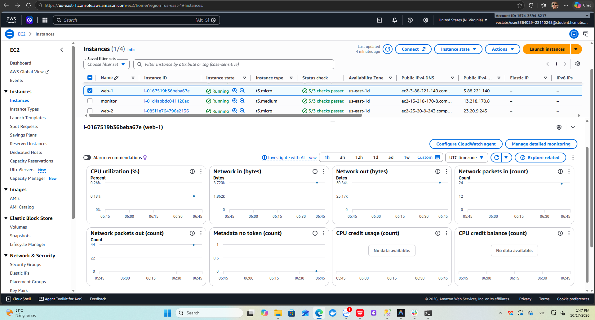

> **[ẢNH 3.2] Metric mặc định không có RAM/Disk**
> - Chụp tại: **CloudWatch → Metrics → All metrics → EC2 → Per-Instance Metrics**, tìm theo instance id của web-1
> - Phải thấy: chỉ có CPUUtilization, NetworkIn/Out, DiskRead/Write (instance store), StatusCheckFailed…, **không có** memory / disk used
> - Lưu file: `images/w3-02-cw-default-metrics.png`

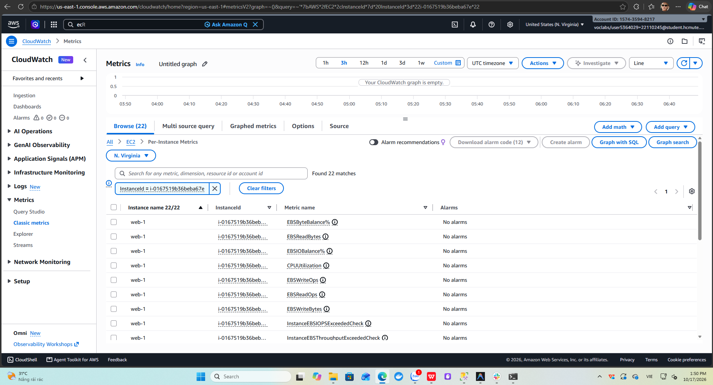

## 3. CloudWatch Agent (RAM, Disk)

### 3.1 Cài đặt trên từng target

```bash
wget https://s3.amazonaws.com/amazoncloudwatch-agent/ubuntu/amd64/latest/amazon-cloudwatch-agent.deb
sudo dpkg -i amazon-cloudwatch-agent.deb
```

### 3.2 Cấu hình `/opt/aws/amazon-cloudwatch-agent/bin/config.json`

```json
{
  "agent": { "metrics_collection_interval": 60, "run_as_user": "root" },
  "metrics": {
    "namespace": "CWAgent",
    "append_dimensions": { "InstanceId": "${aws:InstanceId}" },
    "metrics_collected": {
      "mem":  { "measurement": ["mem_used_percent"] },
      "disk": { "measurement": ["used_percent"], "resources": ["/"], "ignore_file_system_types": ["tmpfs", "overlay", "squashfs"] },
      "cpu":  { "measurement": ["cpu_usage_idle"], "totalcpu": true }
    }
  }
}
```

```bash
sudo /opt/aws/amazon-cloudwatch-agent/bin/amazon-cloudwatch-agent-ctl \
  -a fetch-config -m ec2 -s \
  -c file:/opt/aws/amazon-cloudwatch-agent/bin/config.json
sudo /opt/aws/amazon-cloudwatch-agent/bin/amazon-cloudwatch-agent-ctl -a status
```

Agent dùng quyền `cloudwatch:PutMetricData` của LabInstanceProfile, không cần access key.

> **[ẢNH 3.3] CloudWatch Agent đang chạy**
> - Chụp tại: **terminal SSH vào web-1**, lệnh `amazon-cloudwatch-agent-ctl -a status`
> - Phải thấy: `"status": "running"`
> - Lưu file: `images/w3-03-cw-agent-status.png`

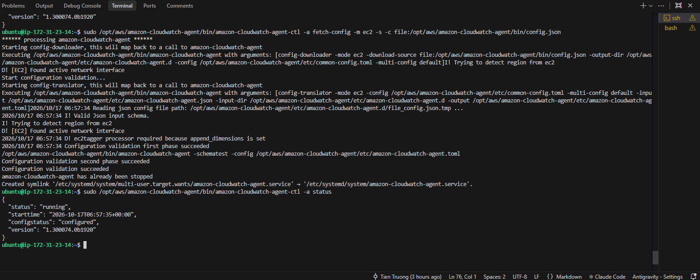

> **[ẢNH 3.4] Custom metrics CWAgent**
> - Chụp tại: **CloudWatch → Metrics → All metrics → CWAgent → InstanceId**
> - Phải thấy: `mem_used_percent` của 3 instance; `disk_used_percent` (nhóm InstanceId, device, fstype, path)
> - Lưu file: `images/w3-04-cwagent-metrics.png`

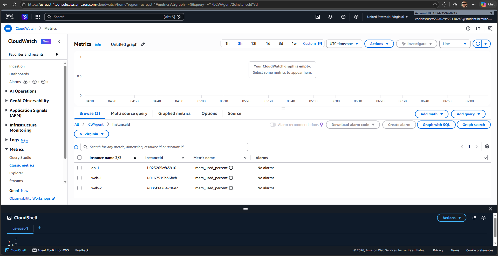

## 4. CloudWatch Dashboard

**CloudWatch → Dashboards → Create dashboard** `prom-monitoring-compare`, thêm widget Line:

| Widget | Namespace / Metric | Period |
|---|---|---|
| CPU Utilization | AWS/EC2 · CPUUtilization (3 instance) | 1 phút |
| Memory Used % | CWAgent · mem_used_percent | 1 phút |
| Disk Used % (/) | CWAgent · disk_used_percent | 1 phút |
| Network In/Out | AWS/EC2 · NetworkIn, NetworkOut | 1 phút |
| Status Check | AWS/EC2 · StatusCheckFailed | 1 phút |

> **[ẢNH 3.5] CloudWatch Dashboard**
> - Chụp tại: **CloudWatch → Dashboards → prom-monitoring-compare** (time range 1h)
> - Phải thấy: 5 widget có dữ liệu của 3 máy
> - Lưu file: `images/w3-05-cw-dashboard.png`

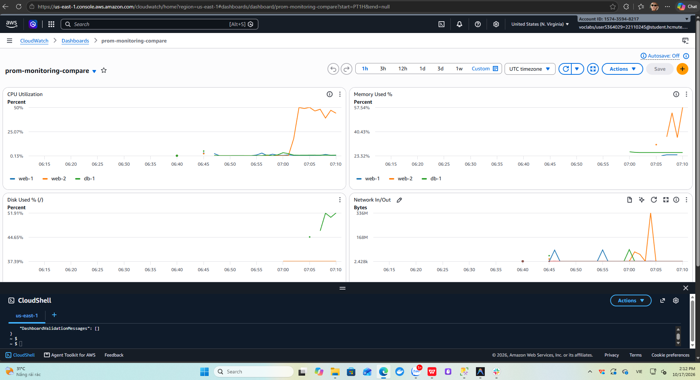

## 5. CloudWatch Alarm + SNS

### 5.1 SNS

1. **SNS → Topics → Create topic** · Standard · tên `prom-monitoring-alerts` · tag `Project`, `Owner`
2. **Create subscription** · Protocol **Email** · nhập email → mở mail bấm **Confirm subscription**

### 5.2 Alarm tương ứng với rule Prometheus

| Alarm | Metric | Điều kiện | Datapoints | Tương ứng rule Prometheus |
|---|---|---|---|---|
| `web-1-HighCPU` (×3 máy) | AWS/EC2 CPUUtilization | > 80 | 5 / 5 (period 1 phút) | HighCPUUsage |
| `web-1-HighRAM` (×3 máy) | CWAgent mem_used_percent | > 90 | 5 / 5 | HighRAMUsage |
| `web-1-StatusCheck` (×3 máy) | AWS/EC2 StatusCheckFailed | ≥ 1 | 1 / 1 | NodeDown (mức hạ tầng) |

Action: **In alarm** và **OK** → SNS topic `prom-monitoring-alerts`.

> **[ẢNH 3.6] SNS subscription đã xác nhận**
> - Chụp tại: **SNS → Topics → prom-monitoring-alerts → tab Subscriptions**
> - Phải thấy: Protocol Email, Status **Confirmed**
> - Lưu file: `images/w3-06-sns-subscription.png`

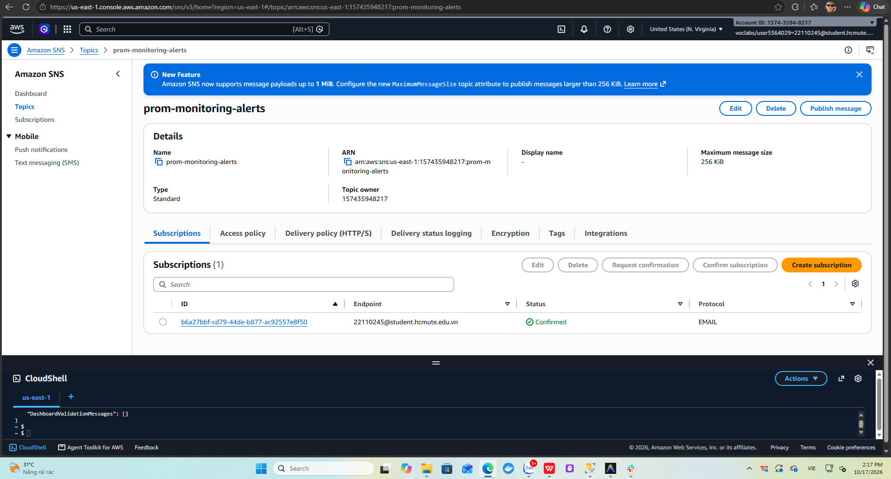

> **[ẢNH 3.7] Danh sách CloudWatch Alarms**
> - Chụp tại: **CloudWatch → Alarms → All alarms**
> - Phải thấy: các alarm ở trạng thái OK, cột Conditions
> - Lưu file: `images/w3-07-cw-alarms.png`

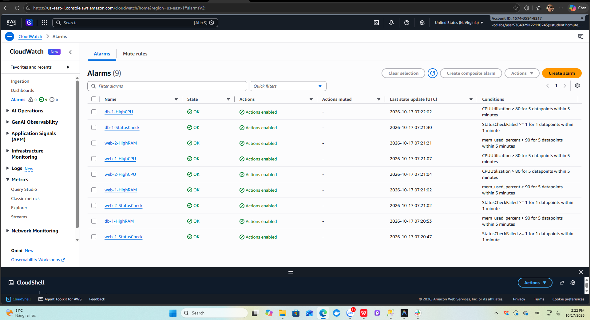

## 6. Tích hợp CloudWatch vào Grafana

Datasource `CloudWatch` đã được provision sẵn trong [`grafana/provisioning/datasources/datasource.yml`](../../grafana/provisioning/datasources/datasource.yml) với `authType: default` (dùng credentials của LabInstanceProfile qua IMDS) và `defaultRegion: us-east-1`.

Tạo dashboard `Prometheus vs CloudWatch` gồm 2 panel đặt cạnh nhau cho cùng một máy:
- Panel trái (Prometheus): `100 - (avg by (hostname) (irate(node_cpu_seconds_total{mode="idle", hostname="web-1"}[1m])) * 100)`
- Panel phải (CloudWatch): Namespace `AWS/EC2`, Metric `CPUUtilization`, Dimension `InstanceId = <id web-1>`, Period 1m

> **[ẢNH 3.8] Datasource CloudWatch hoạt động**
> - Chụp tại: **Grafana → Connections → Data sources → CloudWatch → Save & test**
> - Phải thấy: *Data source is working* (đọc được metrics và logs)
> - Lưu file: `images/w3-08-grafana-cw-datasource.png`

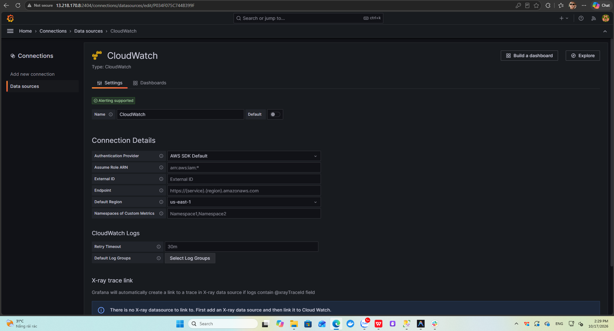

> **[ẢNH 3.9] Dashboard so sánh trên Grafana**
> - Chụp tại: **Grafana → Dashboards → Prometheus vs CloudWatch** trong lúc chạy stress
> - Phải thấy: hai đường CPU cùng một máy, đường Prometheus mịn hơn (15s) và phản ứng sớm hơn đường CloudWatch (1 phút)
> - Lưu file: `images/w3-09-grafana-compare.png`

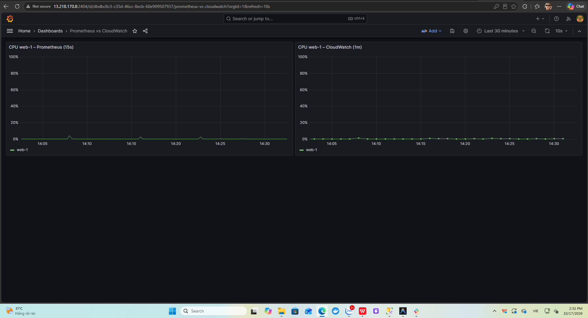

## 7. Kiểm thử tải và đo độ trễ cảnh báo

### 7.1 Kịch bản

```bash
sudo apt install -y stress-ng
date; stress-ng --cpu 2 --timeout 600s
date; stress-ng --vm 1 --vm-bytes 92% --vm-keep --timeout 600s
date; sudo systemctl stop node_exporter
```

Ghi thời điểm bắt đầu (lệnh `date`), thời điểm tin Slack đến, thời điểm email SNS đến.

### 7.2 Kết quả đo

| Kịch bản | Máy | Bắt đầu | Slack (Prometheus) | Email (CloudWatch) | Độ trễ Prometheus | Độ trễ CloudWatch |
|---|---|---|---|---|---|---|
| CPU 100% | web-1 | ..:..:.. | ..:..:.. | ..:..:.. | … phút | … phút |
| RAM 92% | web-2 | ..:..:.. | ..:..:.. | ..:..:.. | … phút | … phút |
| Dừng node_exporter | db-1 | ..:..:.. | ..:..:.. | *không báo* | … phút | – |
| Hết sự cố (resolved / OK) | web-1 | ..:..:.. | ..:..:.. | ..:..:.. | … phút | … phút |

**Nhận xét cần lưu ý khi phân tích:**
- Độ trễ Prometheus ≈ `for` của rule + `group_wait` (15s) + chu kỳ scrape/evaluate (15s).
- Độ trễ CloudWatch ≈ số datapoint × period + độ trễ đẩy metric (thường 1–3 phút).
- Dừng node_exporter: Prometheus phát hiện được (`up == 0`) vì giám sát ở **mức dịch vụ**; CloudWatch StatusCheck vẫn OK vì máy ảo vẫn chạy → CloudWatch chỉ giám sát ở **mức hạ tầng**.

> **[ẢNH 3.10] Terminal chạy stress-ng**
> - Chụp tại: **terminal SSH vào web-1**, chạy `stress-ng` cùng `htop` (chia đôi màn hình)
> - Phải thấy: lệnh `date`, CPU 100%
> - Lưu file: `images/w3-10-stress-cpu.png`

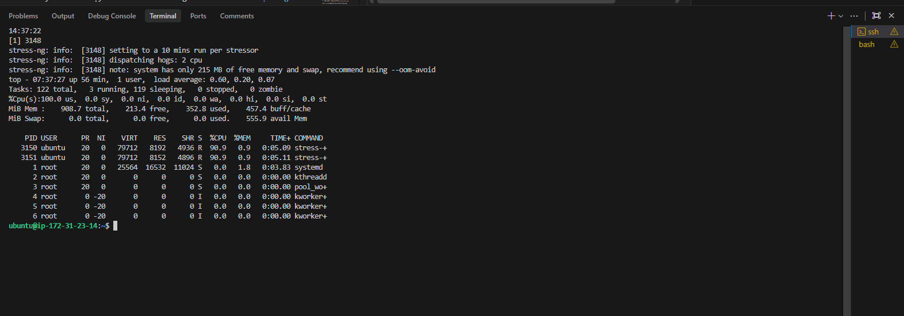

> **[ẢNH 3.11] Slack nhận HighCPUUsage**
> - Chụp tại: **Slack → #alerts**
> - Phải thấy: tin FIRING `HighCPUUsage` với hostname web-1 và giá trị %, timestamp
> - Lưu file: `images/w3-11-slack-highcpu.png`

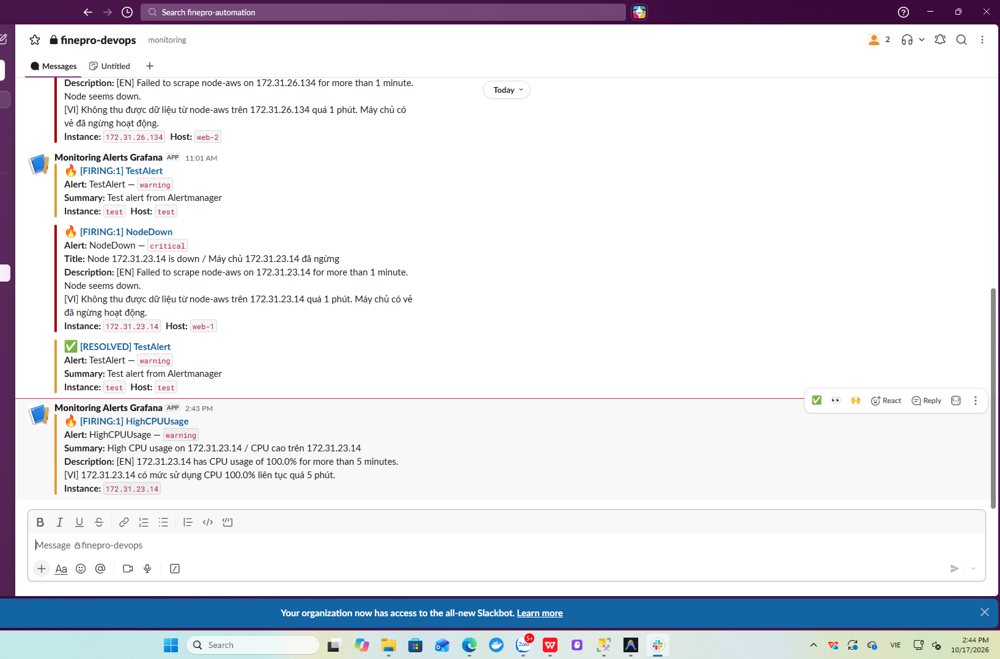

> **[ẢNH 3.12] Alarm CloudWatch chuyển In alarm**
> - Chụp tại: **CloudWatch → Alarms → web-1-HighCPU** (tab History)
> - Phải thấy: biểu đồ vượt ngưỡng 80, lịch sử chuyển trạng thái OK → ALARM kèm thời gian
> - Lưu file: `images/w3-12-cw-alarm-state.png`

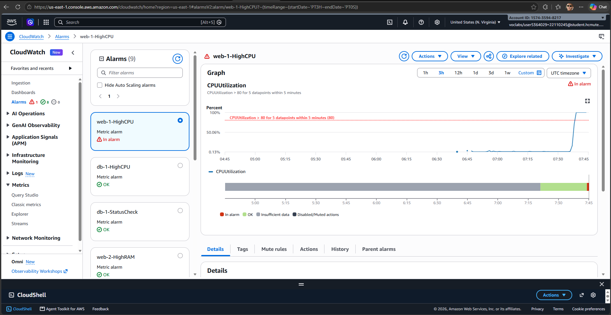

> **[ẢNH 3.13] Email SNS**
> - Chụp tại: **hộp thư email** đã subscribe
> - Phải thấy: email *ALARM: "web-1-HighCPU" in US East (N. Virginia)* và thời gian nhận
> - Lưu file: `images/w3-13-sns-email.png`

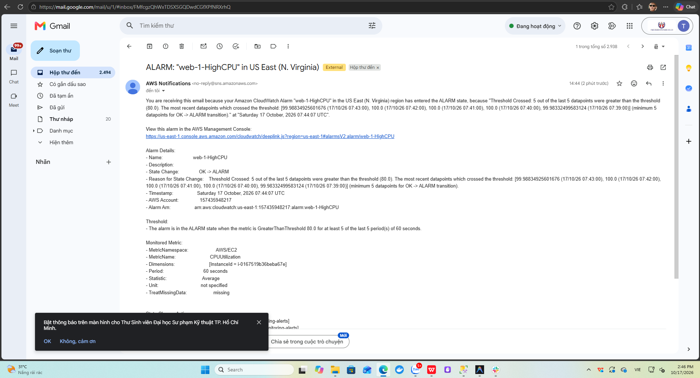

> **[ẢNH 3.14] Slack nhận HighRAMUsage**
> - Chụp tại: **Slack → #alerts**
> - Phải thấy: tin FIRING `HighRAMUsage` của web-2
> - Lưu file: `images/w3-14-slack-highram.png`

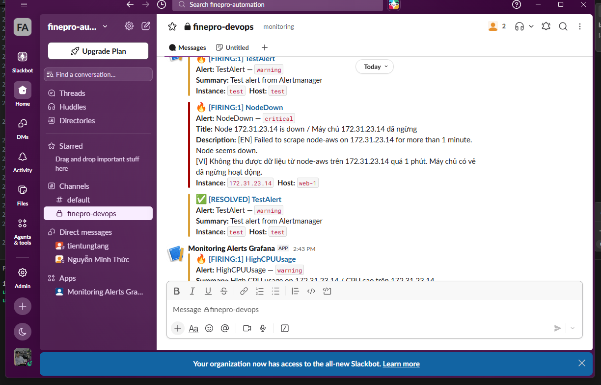

> **[ẢNH 3.15] CloudWatch không phát hiện node_exporter bị dừng**
> - Chụp tại: **CloudWatch → Alarms → db-1-StatusCheck** cùng thời điểm Slack đang báo NodeDown cho db-1
> - Phải thấy: alarm vẫn **OK**
> - Lưu file: `images/w3-15-cw-statuscheck-ok.png`

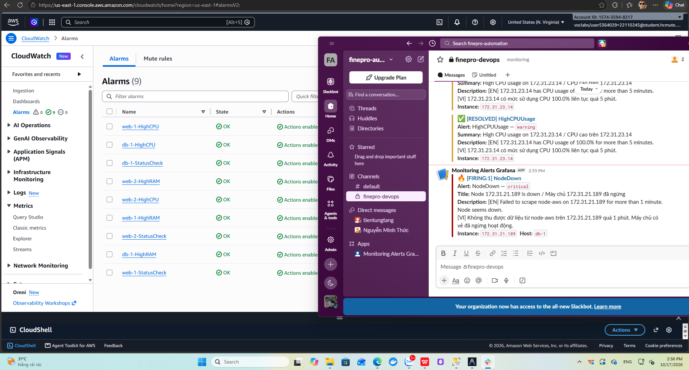

## 8. Bảo mật

| Lớp | Biện pháp | Minh chứng |
|---|---|---|
| Mạng | Port 9100 chỉ mở cho sg-monitor; 22/2404/9090 chỉ mở cho IP cá nhân `/32` | Ảnh 1.6, 1.7, 2.16 |
| Mạng | Prometheus scrape qua private IP trong VPC | Ảnh 2.8 |
| Xác thực | node_exporter và Prometheus dùng basic auth (bcrypt) | Ảnh 2.5 |
| Xác thực | Grafana đổi mật khẩu admin qua `.env` | – |
| Bề mặt tấn công | Alertmanager bind `127.0.0.1`, chỉ vào được qua SSH tunnel | Ảnh 2.6, 2.13 |
| IAM | Chỉ dùng LabInstanceProfile, không có access key trên máy | Ảnh 2.2 |
| Bí mật | `secrets/`, `.env`, `web.yml` nằm trong `.gitignore`, không có trên Git | Ảnh 3.16 |
| Dữ liệu | EBS gp3, S3 chặn public access, bật versioning | Ảnh 1.8 |

> **[ẢNH 3.16] Bí mật không bị đẩy lên Git**
> - Chụp tại: **trang repo trên GitHub/GitLab**, thư mục gốc nhánh `feature/aws_project`
> - Phải thấy: không có thư mục `secrets/`, file `.env`, `prometheus/web.yml`
> - Lưu file: `images/w3-16-git-no-secrets.png`

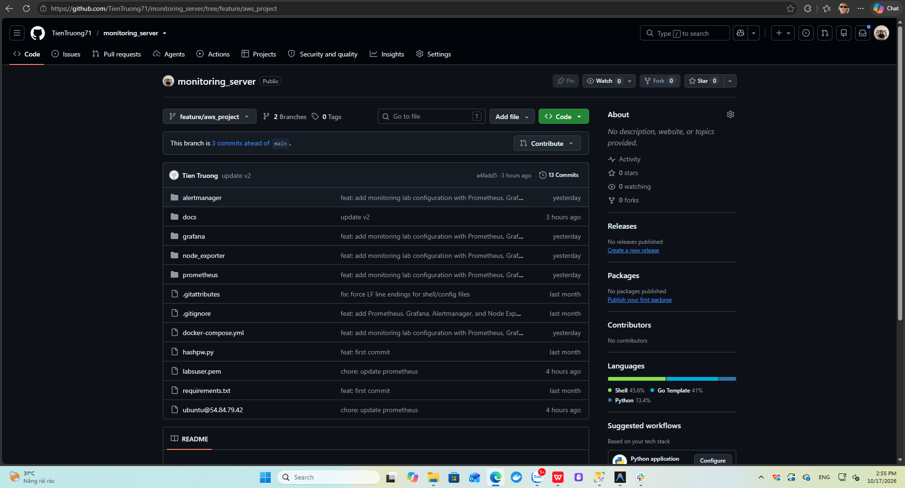

## 9. Tự động hóa hạ tầng bằng CloudFormation (IaC)

Tuần 1–3, hạ tầng được tạo thủ công trên console nên mất nhiều thời gian và dễ sai sót (quên tag `Monitoring=node`, quên gắn IAM role, quên hop limit 2). Template [`infra/stack.yml`](../../infra/stack.yml) mô tả lại toàn bộ hạ tầng đó dưới dạng mã. Chỉ cần một lệnh để dựng lại từ đầu và một lệnh để xóa sạch sau buổi lab.

### 9.1 Nội dung template

| Nhóm | Tài nguyên | Ghi chú |
|---|---|---|
| Mạng | VPC `10.20.0.0/16`, public subnet `10.20.1.0/24`, Internet Gateway, route table | Tách riêng khỏi VPC mặc định |
| Bảo mật | `prom-monitor-sg`: 22, 2404, 9090 chỉ từ `MyIp` | Giống `monitor-sg` |
| | `prom-target-sg`: 22 từ `MyIp`; 9100 chỉ từ `prom-monitor-sg` | Giống `sg-target` |
| Launch template | Monitor: t3.medium, 20 GB gp3, IMDSv2 bắt buộc, **hop limit 2** | User data cài Docker, Compose, Git |
| | Target: t3.micro, 8 GB gp3, Detailed Monitoring theo tham số | User data cài node_exporter có basic auth, CloudWatch Agent (cấu hình giống mục 3.2), stress-ng |
| EC2 | `monitor`, `web-1`, `web-2`, `db-1` | Đều gắn `LabInstanceProfile`, tag `Project`, `Owner`; 3 target có tag `Monitoring` |
| Outputs | Public IP, URL Grafana/Prometheus, instance ID 3 target | Dùng cho bước kiểm tra |

Tham số:

| Tham số | Mặc định | Ý nghĩa |
|---|---|---|
| `MyIp` | (bắt buộc) | IP cá nhân dạng `x.x.x.x/32` |
| `ExporterBasicAuth` | (bắt buộc, ẩn) | Chuỗi `node_exporter: $2b$12$...` sinh từ `hashpw.py` (mục 3.1 tuần 2) |
| `Owner` | `22110245` | Tag Owner |
| `KeyName` | `vockey` | Key pair của Learner Lab |
| `MonitoringTag` | `node` | Giá trị tag mà `ec2_sd_configs` lọc |
| `DetailedMonitoring` | `false` | `true` để bật chu kỳ 1 phút |
| `UbuntuAmi` | SSM `ubuntu/server/24.04/.../ami-id` | Luôn lấy AMI Ubuntu mới nhất, không cần sửa ID |

Template đã được kiểm tra cú pháp bằng `cfn-lint` (không có lỗi).

### 9.2 Triển khai

> **Lưu ý:** Khi hệ thống thủ công vẫn đang chạy, Prometheus cũ cũng lọc tag `Monitoring=node` trong cùng region. Nếu giữ mặc định, nó sẽ phát hiện 3 target mới nhưng không scrape được (khác VPC) và bắn `NodeDown` lên Slack. Vì vậy khi chỉ triển khai để minh chứng, đặt `MonitoringTag=node-iac`. Khi dùng stack này thay thế hẳn hệ thống cũ thì stop 4 máy cũ trước và giữ `node`.

1. Mở **CloudShell → Actions → Upload file**, chọn `infra/stack.yml`.
2. Kiểm tra template trên AWS:
   ```bash
   aws cloudformation validate-template --template-body file://stack.yml
   ```
3. Triển khai (thay IP và chuỗi bcrypt; chuỗi bcrypt để trong **nháy đơn**):
   ```bash
   aws cloudformation deploy \
     --template-file stack.yml \
     --stack-name prom-monitoring \
     --parameter-overrides \
       MyIp=<ip-ca-nhan>/32 \
       'ExporterBasicAuth=node_exporter: $2b$12$...' \
       MonitoringTag=node-iac \
     --tags Project=prom-monitoring Owner=22110245
   ```
   Lệnh chờ đến khi stack ở trạng thái `CREATE_COMPLETE` (khoảng 3–4 phút).
4. Xem output:
   ```bash
   aws cloudformation describe-stacks --stack-name prom-monitoring --query "Stacks[0].Outputs" --output table
   ```
5. Kiểm tra user data đã chạy xong trên một target (đợi thêm 2–3 phút sau khi stack xong):
   ```bash
   ssh -i labsuser.pem ubuntu@<Web1PublicIp>
   systemctl is-active node_exporter amazon-cloudwatch-agent
   curl -s -o /dev/null -w "%{http_code}\n" localhost:9100/metrics
   ```
   Kết quả mong đợi: hai dòng `active` và mã `401` (basic auth hoạt động).
6. Trên máy `monitor` mới: clone repo, tạo `secrets/`, `.env`, `prometheus/web.yml` và chạy `docker compose up -d` như mục 4 tuần 2. Docker đã được user data cài sẵn. Nếu dùng `MonitoringTag=node-iac` thì sửa giá trị filter `tag:Monitoring` trong `prometheus/prometheus.yml` thành `node-iac` trước khi chạy.

> **[ẢNH 3.17] CloudFormation stack**
> - Chụp tại: **CloudFormation → Stacks → prom-monitoring → tab Resources**
> - Phải thấy: trạng thái **CREATE_COMPLETE**, danh sách tài nguyên (VPC, Subnet, SG, LaunchTemplate, 4 Instance…)
> - Lưu file: `images/w3-17-cloudformation.png`

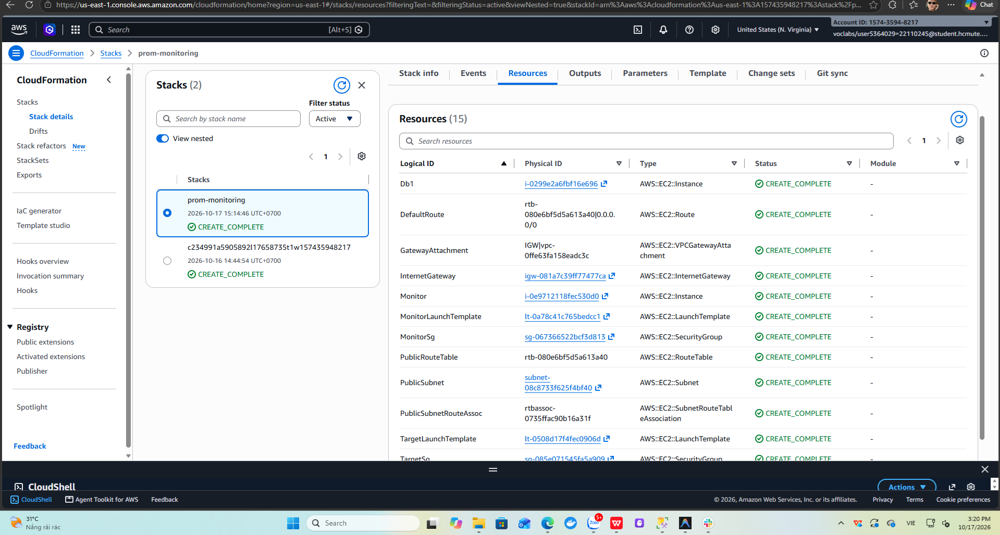

> **[ẢNH 3.18] Outputs và target do user data cài sẵn**
> - Chụp tại: **CloudFormation → prom-monitoring → tab Outputs**, kèm terminal SSH vào web-1 mới chạy lệnh ở bước 5
> - Phải thấy: Public IP và URL; `active` `active` `401`
> - Lưu file: `images/w3-18-cfn-outputs.png`


### 9.3 Dọn dẹp

```bash
aws cloudformation delete-stack --stack-name prom-monitoring
aws cloudformation wait stack-delete-complete --stack-name prom-monitoring
```

Xóa stack sẽ xóa toàn bộ tài nguyên đã tạo (EC2, EBS, SG, VPC), tránh tốn credit Learner Lab. Các alarm và dashboard CloudWatch tạo bằng tay ở mục 4–5 không nằm trong stack nên không bị ảnh hưởng.

## 10. Kết quả tuần 3

| Hạng mục | Kết quả |
|---|---|
| Detailed Monitoring cho 3 target | ☐ |
| CloudWatch Agent gửi RAM/Disk | ☐ |
| CloudWatch Dashboard | ☐ |
| Alarm + SNS email hoạt động | ☐ |
| Grafana đọc được CloudWatch | ☐ |
| Đo độ trễ cảnh báo 4 kịch bản | ☐ |
| Rà soát bảo mật | ☐ |
| IaC CloudFormation | ☐ |

## 11. Khó khăn và cách giải quyết

| Khó khăn | Nguyên nhân | Cách giải quyết |
|---|---|---|
| ……… | ……… | ……… |

## 12. Nhật ký công việc (Worklog)

| Ngày | Thành viên | Công việc | Số giờ |
|---|---|---|---|
| ……/…… | SV A | Detailed Monitoring, cài và cấu hình CloudWatch Agent | … |
| ……/…… | SV A | CloudWatch Dashboard, Alarm, SNS; viết CloudFormation | … |
| ……/…… | SV B | Datasource CloudWatch, dashboard so sánh trên Grafana | … |
| ……/…… | SV B | Chạy stress-ng, đo độ trễ, rà soát bảo mật | … |
| | | **Tổng SV A** | **… (≥ 8)** |
| | | **Tổng SV B** | **… (≥ 8)** |

## 13. Phần có AI hỗ trợ

| Nội dung | Công cụ AI | Mức độ | SV đã kiểm chứng |
|---|---|---|---|
| Cấu hình CloudWatch Agent, datasource CloudWatch | Claude | Sinh cấu hình, SV kiểm tra trên console | ……… |
| Kịch bản stress-ng và cách đo độ trễ | Claude | Tham khảo | ……… |

## 14. Kế hoạch tuần 4

- Kiểm thử tổng thể end-to-end.
- Hoàn thiện bảng so sánh Prometheus + Grafana và CloudWatch.
- Báo cáo chi phí, tối ưu chi phí, dọn dẹp tài nguyên.
- Viết báo cáo cuối kỳ, quay video demo ≤ 10 phút.
