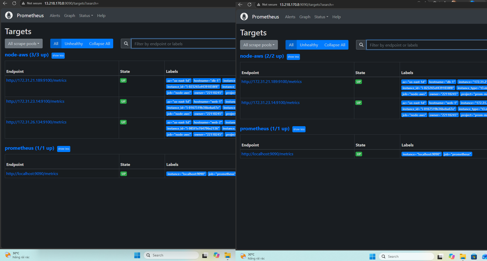
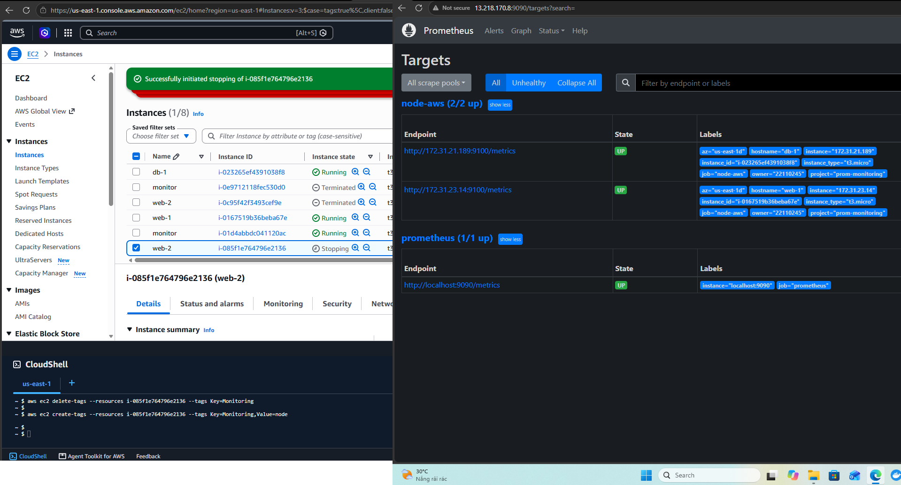
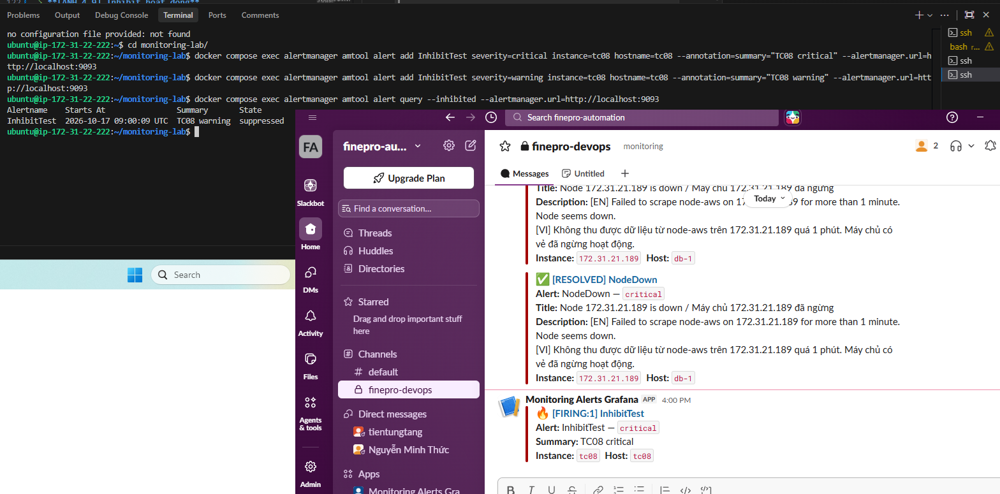
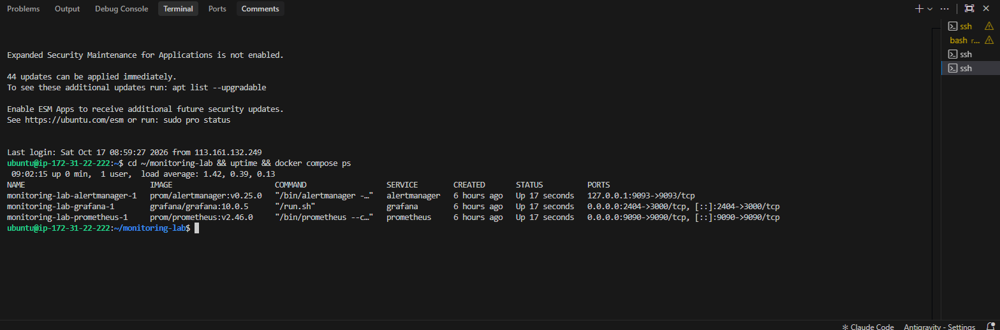
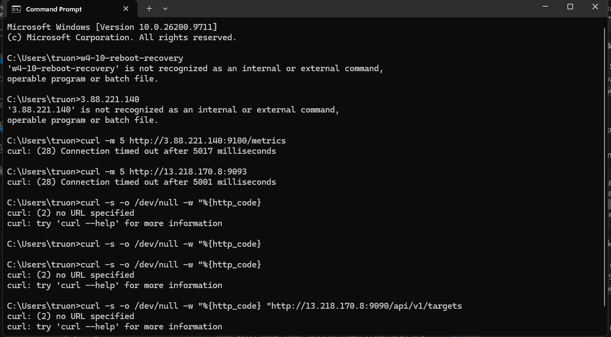
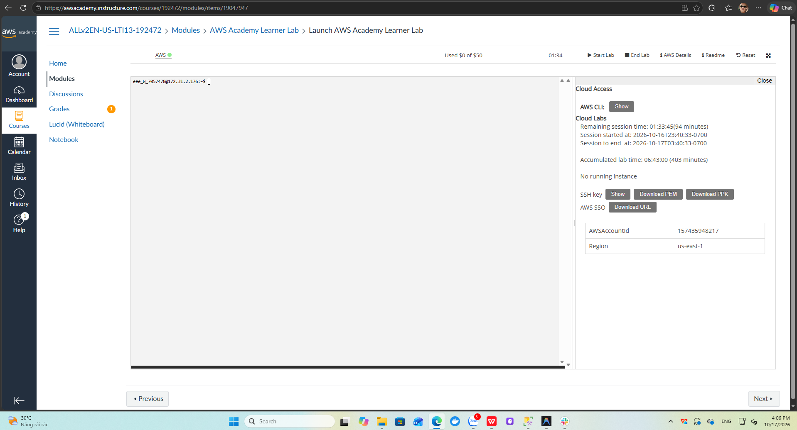
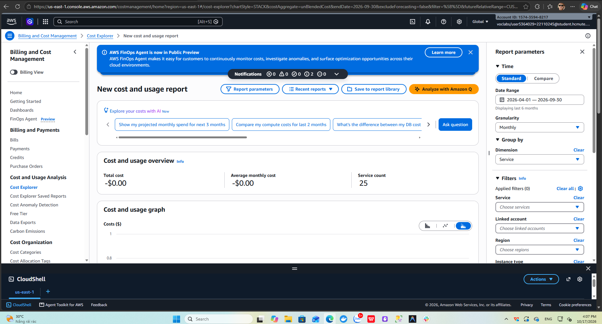
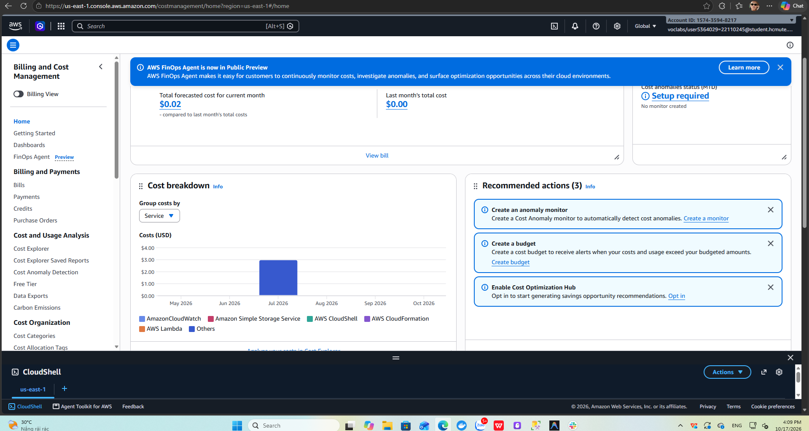

# Báo cáo Tuần 4 – Kiểm thử tổng thể, so sánh, chi phí, dọn dẹp

**Đề tài:** Hệ thống giám sát mã nguồn mở Prometheus + Grafana trên AWS (Nhóm: Infrastructure)
**Thời gian:** ……/……/2026 – ……/……/2026
**Thành viên:** Trương Thành Tiến – MSSV 22110245 · Lê Nguyễn Thiên Phúc – MSSV ………
**Region:** us-east-1 · **Account ID:** 1574-3594-8217

---

## 1. Mục tiêu tuần

- Kiểm thử end-to-end toàn hệ thống.
- Hoàn thiện bảng so sánh Prometheus + Grafana với Amazon CloudWatch.
- Báo cáo chi phí, đề xuất tối ưu, dọn dẹp tài nguyên.
- Hoàn thiện báo cáo và sơ đồ kiến trúc.

## 2. Kiểm thử tổng thể

### 2.1 Danh sách test case

| # | Test case | Bước thực hiện | Kết quả mong đợi | Kết quả | Hình |
|---|---|---|---|---|---|
| TC01 | Service discovery thêm/bớt máy | Gỡ tag `Monitoring` của web-2, sau đó gắn lại | Target biến mất / xuất hiện trong ≤ 60s | ☑ Đạt | 4.1 |
| TC02 | Máy bị stop | Stop web-2 trên console | Target biến mất khỏi danh sách, không có NodeDown | ☑ Đạt | 4.2 |
| TC03 | Dịch vụ exporter chết | `systemctl stop node_exporter` trên db-1 | Slack NodeDown sau ~1 phút; CloudWatch vẫn OK | ☑ Đạt | 4.3 |
| TC04 | CPU cao | `stress-ng --cpu 2` trên web-1 | Slack HighCPUUsage; email SNS | ☑ Đạt | 4.4, 4.5 |
| TC05 | RAM cao | `stress-ng --vm 1 --vm-bytes 92%` trên web-2 | Slack HighRAMUsage; email SNS | ☐ Chưa kiểm thử | – |
| TC06 | Disk đầy | `fallocate` đến khi ổ còn trống 10% trên db-1 | Slack HighDiskUsage | ☐ Chưa kiểm thử | – |
| TC07 | Resolved | Dừng stress, bật lại node_exporter | Slack RESOLVED; email OK | ☑ Đạt | 4.3, 4.6 |
| TC08 | Inhibit | Gửi 2 alert cùng `alertname` + `instance` (critical và warning) bằng `amtool` | Chỉ alert critical được gửi, warning bị chặn | ☑ Đạt | 4.6 |
| TC09 | Khởi động lại monitor | `sudo reboot` máy monitor | Container tự chạy lại, dữ liệu cũ còn | ☑ Đạt | 4.7 |
| TC10 | Bảo mật | `curl` tới 9100 của target, 9093 và 9090 của monitor không mật khẩu | Timeout / timeout / 401 | ☑ Đạt | 4.8 |

### 2.2 TC01 – Service discovery theo tag

```bash
aws ec2 delete-tags --resources i-085f1e764796e2136 --tags Key=Monitoring
aws ec2 create-tags --resources i-085f1e764796e2136 --tags Key=Monitoring,Value=node
```

Sau khi gỡ tag, job `node-aws` giảm từ 3/3 xuống 2/2 trong lần refresh kế tiếp (`refresh_interval: 60s`) mà không cần sửa cấu hình hay reload Prometheus. Gắn lại tag thì web-2 tự xuất hiện trở lại.



*Hình 4.1: Targets trước (3/3) và sau (2/2) khi gỡ tag Monitoring của web-2*

### 2.3 TC02 – Máy bị stop

Khi web-2 (`i-085f1e764796e2136`) chuyển sang *Stopping*, Prometheus loại web-2 khỏi danh sách target nhờ filter `instance-state-name=running`, job `node-aws` còn 2/2 và **không** phát sinh `NodeDown`. Đây là hành vi mong muốn: máy dừng có chủ đích không phải là sự cố. Sau khi start lại, web-2 nhận public IP mới nhưng Prometheus vẫn scrape qua private IP nên không cần sửa gì.



*Hình 4.2: web-2 Stopping trên EC2, Targets còn 2/2*

> **Lưu ý:** Phải stop đúng web-2 gốc (`i-085f1e764796e2136`). Máy web-2 do stack CloudFormation tạo mang tag `Monitoring=node-iac` nên không thuộc phạm vi giám sát của Prometheus hiện tại.

### 2.4 TC03, TC04 – Exporter chết và CPU cao

Hai test case này đã thực hiện trong mục 7 tuần 3:

| Kịch bản | Bắt đầu | Slack (Prometheus) | Email (CloudWatch) |
|---|---|---|---|
| CPU 100% trên web-1 | 14:37:22 | 14:43 | 14:44:07 |
| Dừng node_exporter trên db-1 | – | 14:55 (NodeDown) | không báo, `db-1-StatusCheck` vẫn OK |


*Hình 4.3: Slack báo NodeDown db-1 trong khi 9 alarm CloudWatch vẫn OK; phía trên là tin RESOLVED HighCPUUsage*


*Hình 4.4: Slack nhận HighCPUUsage của web-1*


*Hình 4.5: Email SNS ALARM web-1-HighCPU*

### 2.5 TC05, TC06 – RAM cao và ổ đĩa đầy

Chưa thực hiện trong thời gian lab. Quy trình đã chuẩn bị:

- **RAM:** trên web-2 chạy `stress-ng --vm 1 --vm-bytes 92% --vm-keep --timeout 600s`, kiểm tra `free -m` để mức sử dụng vượt 90% (t3.micro có 909 MiB). Rule `HighRAMUsage` (`for: 5m`) và alarm `web-2-HighRAM` (5/5 datapoint) cùng phải báo.
- **Disk:** ổ root của db-1 chỉ có 7 GiB nên tạo file theo dung lượng còn trống, để lại 10%:
  ```bash
  AVAIL=$(df --output=avail -B1 / | tail -1); SIZE=$(df --output=size -B1 / | tail -1)
  sudo fallocate -l $((AVAIL - SIZE/10)) /var/tmp/fill
  sudo rm /var/tmp/fill
  ```
  Rule `HighDiskUsage` báo khi dung lượng trống < 20% trong 5 phút. CloudWatch không có alarm dung lượng ổ đĩa, chỉ có widget Disk Used % trên dashboard.

### 2.6 TC07, TC08 – Resolved và Inhibit

**Resolved:** sau khi stress-ng trên web-1 kết thúc, Slack nhận `[RESOLVED] HighCPUUsage` (Hình 4.3). Sau khi bật lại node_exporter trên db-1, Slack nhận `[RESOLVED] NodeDown` (Hình 4.6). Cả hai nhờ `send_resolved: true` trong Alertmanager.

**Inhibit:** các rule hiện tại không có alertname nào vừa có mức critical vừa có mức warning, nên quy tắc inhibit (`equal: [alertname, instance]`) được kiểm tra bằng 2 alert giả trên máy monitor:

```bash
cd ~/monitoring-lab
docker compose exec alertmanager amtool alert add InhibitTest severity=critical instance=tc08 hostname=tc08 --annotation=summary="TC08 critical" --alertmanager.url=http://localhost:9093
docker compose exec alertmanager amtool alert add InhibitTest severity=warning instance=tc08 hostname=tc08 --annotation=summary="TC08 warning" --alertmanager.url=http://localhost:9093
docker compose exec alertmanager amtool alert query --inhibited --alertmanager.url=http://localhost:9093
```

Kết quả: alert warning có State **suppressed**, Slack chỉ nhận một tin `[FIRING:1] InhibitTest` mức critical.



*Hình 4.6: Alert warning bị suppressed, Slack chỉ nhận alert critical; phía trên là tin RESOLVED NodeDown của db-1*

### 2.7 TC09 – Khởi động lại máy monitor

```bash
sudo reboot
cd ~/monitoring-lab && uptime && docker compose ps
```

Sau khi reboot (`up 0 min`), cả 3 container `prometheus`, `alertmanager`, `grafana` tự chạy lại (*Up 17 seconds*) nhờ `restart: unless-stopped` và Docker được bật cùng hệ thống. Dữ liệu metric được giữ trong volume `prometheus_data` nên không mất lịch sử.



*Hình 4.7: 3 container tự khôi phục sau khi reboot máy monitor*

### 2.8 TC10 – Bảo mật mạng

Chạy từ máy cá nhân (Command Prompt):

```bat
curl -m 5 http://3.88.221.140:9100/metrics
curl -m 5 http://13.218.170.8:9093
curl -s -o NUL -w "%{http_code}" http://13.218.170.8:9090/api/v1/targets
```

| Kiểm tra | Kết quả | Lý do |
|---|---|---|
| node_exporter của web-1 qua Internet | `Connection timed out` | `sg-target` chỉ mở 9100 cho `monitor-sg` |
| Alertmanager qua Internet | `Connection timed out` | Bind `127.0.0.1`, `monitor-sg` không mở 9093 |
| Prometheus không mật khẩu | `401` | Basic auth bằng `web.yml` |



*Hình 4.8: Cổng 9100 và 9093 bị chặn từ Internet*

## 3. So sánh Prometheus + Grafana và Amazon CloudWatch

| Tiêu chí | Prometheus + Grafana (tự triển khai) | Amazon CloudWatch |
|---|---|---|
| Mô hình | Pull – Prometheus scrape `/metrics` | Push – hypervisor / Agent đẩy metric |
| Độ phân giải mặc định | 15 giây (`scrape_interval`) | 5 phút (basic), 1 phút (detailed, có phí) |
| RAM / Disk | Có sẵn từ node_exporter | Cần cài CloudWatch Agent (custom metric, có phí) |
| Độ trễ cảnh báo đo được (CPU) | ≈ 5 phút 40 giây (14:37:22 → 14:43) | ≈ 6 phút 45 giây (14:37:22 → 14:44:07) |
| Mức giám sát | Dịch vụ + hệ điều hành (phát hiện exporter/app chết, TC03) | Hạ tầng (máy ảo, status check); dịch vụ cần thêm custom metric |
| Ngôn ngữ truy vấn | PromQL (rate, aggregation, subquery…) | Metric Math, Metrics Insights (SQL-like) |
| Service discovery | `ec2_sd_configs` theo tag, cập nhật trong ≤ 60s (TC01) | Tự có cho mọi tài nguyên AWS |
| Kênh cảnh báo | Alertmanager: Slack, Telegram, email, webhook…; group/inhibit/silence (TC08) | SNS: email, SMS, Lambda, HTTP; Chatbot cho Slack |
| Lưu trữ | Phụ thuộc EBS, mặc định 15 ngày | 15 tháng (giảm độ phân giải theo thời gian) |
| Vận hành | Tự cài, cập nhật, backup, HA | Managed, không cần bảo trì |
| Bảo mật | Tự cấu hình basic auth, SG, TLS | Tích hợp IAM |
| Đa nền tảng | On-prem, multi-cloud, Kubernetes | Chủ yếu AWS (Agent cài được on-prem) |
| Dashboard | Grafana: phong phú, kho dashboard cộng đồng, đọc được cả CloudWatch | CloudWatch Dashboard: cơ bản hơn |
| Chi phí (3 máy, 24/7) | ~31.97 USD/tháng (mục 4.2) | ~9.90 USD/tháng (mục 4.2) |
| Phù hợp | Hệ thống lớn, nhiều môi trường, cần metric ứng dụng chi tiết | Hệ thống nhỏ/vừa thuần AWS, muốn ít vận hành |

## 4. Chi phí

### 4.1 Chi phí thực tế trong Learner Lab

| Nguồn | Số liệu |
|---|---|
| Learner Lab | Used **$0 of $50**, tổng thời gian lab tích lũy 06:43:00 (403 phút) |
| Cost Explorer (04/2026 – 09/2026, group by Service) | Total cost **-$0.00**, 25 dịch vụ có phát sinh sử dụng |
| Billing Home | Dự báo tháng hiện tại **$0.02**, tháng trước **$0.00** |

Chi phí gần như bằng 0 vì tài khoản Learner Lab được khấu trừ bằng credit và số liệu billing cập nhật chậm khoảng 8–24 giờ.



*Hình 4.9: Ngân sách Learner Lab đã dùng và thông tin tài khoản*



*Hình 4.10: Cost Explorer 6 tháng gần nhất, group by Service*



*Hình 4.11: Billing and Cost Management – dự báo chi phí và Cost breakdown theo dịch vụ*

### 4.2 Ước tính chạy 24/7 trong 1 tháng (730 giờ, us-east-1, giá on-demand tham khảo)

| Hạng mục | Cách tính | USD/tháng |
|---|---|---|
| EC2 monitor t3.medium | 730 × $0.0416 | ~30.37 |
| EBS monitor 20 GB gp3 | 20 × $0.08 | ~1.60 |
| **Chi phí riêng của Prometheus + Grafana** | | **~31.97** |
| Detailed Monitoring 3 máy | 3 × 7 metric × $0.30 | ~6.30 |
| Custom metric CWAgent | 9 metric × $0.30 | ~2.70 |
| CloudWatch Alarms | 9 alarm × $0.10 | ~0.90 |
| CloudWatch Dashboard | 3 dashboard đầu miễn phí | 0.00 |
| SNS email | 1.000 email đầu miễn phí | 0.00 |
| **Chi phí riêng của CloudWatch** | | **~9.90** |
| 3 máy target t3.micro + 24 GB gp3 *(chung cho cả hai)* | 3 × 730 × $0.0104 + 24 × $0.08 | ~24.70 |

Giá lấy theo bảng giá công khai của AWS tại us-east-1.

**Nhận xét:** với quy mô 3 máy, CloudWatch rẻ hơn vì Prometheus cần một EC2 riêng. Chi phí CloudWatch tăng tuyến tính theo số máy và số metric, trong khi một máy Prometheus t3.medium có thể giám sát hàng trăm target, nên Prometheus có lợi hơn khi số máy lớn hoặc cần nhiều metric chi tiết.

### 4.3 Tối ưu chi phí

| Biện pháp | Tác động |
|---|---|
| Stop toàn bộ EC2 sau mỗi buổi lab | Chỉ trả EBS khi không dùng |
| Hạ máy monitor xuống t3.small khi tải thấp | Giảm ~50% chi phí EC2 monitor |
| Giới hạn `--storage.tsdb.retention.time` | Giảm dung lượng EBS cần dùng |
| Chỉ bật Detailed Monitoring / Agent cho máy cần so sánh | Giảm custom metric |
| Dùng CloudFormation để xóa / dựng lại nhanh | Không để sót tài nguyên tính phí |

## 5. Dọn dẹp tài nguyên

Thứ tự dọn dẹp sau khi hoàn tất đề tài (tài nguyên phụ thuộc xóa trước):

| # | Tài nguyên | Thao tác | Trạng thái |
|---|---|---|---|
| 1 | CloudFormation stack `prom-monitoring` | `aws cloudformation delete-stack --stack-name prom-monitoring` | ☑ Đã xóa, 4 máy của stack Terminated (Hình 4.2) |
| 2 | CloudWatch Alarms | CloudWatch → Alarms → chọn tất cả → Delete | ☐ |
| 3 | CloudWatch Dashboard | Dashboards → Delete | ☐ |
| 4 | SNS topic + subscription | SNS → Topics → Delete | ☐ |
| 5 | 4 EC2 | EC2 → Instances → Terminate (EBS root tự xóa) | ☐ |
| 6 | EBS volume / snapshot còn sót | EC2 → Volumes / Snapshots | ☐ |
| 7 | S3 bucket | Empty → Delete | ☐ |
| 8 | Security Groups, VPC | VPC → Your VPCs → Delete VPC (xóa kèm subnet, IGW, route table) | ☐ |

Kiểm tra cuối cùng bằng **Resource Groups & Tag Editor**, tìm tag `Project = prom-monitoring`: kết quả phải là *No resources found*.

## 6. Kết luận

**Kết quả đạt được:**
- Triển khai Prometheus + Grafana + Alertmanager bằng Docker trên EC2, giám sát 3 EC2 qua node_exporter có basic auth, service discovery theo tag.
- Cảnh báo Slack hoạt động với NodeDown, HighCPUUsage, gửi cả FIRING và RESOLVED; inhibit rule hoạt động đúng.
- Triển khai CloudWatch song song (Agent, Dashboard, 9 Alarm, SNS) và so sánh bằng số liệu đo thực tế: Prometheus báo CPU cao sớm hơn CloudWatch khoảng 1 phút, và phát hiện được dịch vụ exporter chết mà CloudWatch không thấy.
- Hệ thống tự khôi phục sau khi reboot máy monitor; các cổng nội bộ không truy cập được từ Internet.
- Tự động hóa hạ tầng bằng CloudFormation (tạo và xóa stack bằng một lệnh).
- Tuân thủ giới hạn Learner Lab: 4 EC2, 8 vCPU, 44 GB gp3, chỉ dùng LabInstanceProfile, gắn tag đầy đủ.

**Hạn chế:**
- Prometheus chỉ chạy một instance, không có HA; máy monitor dừng thì mất giám sát.
- Chưa kiểm thử thực tế cảnh báo RAM cao và ổ đĩa đầy (TC05, TC06).
- Rule `HighCPUUsage` dùng `avg by (instance)` nên tin Slack không có tên máy (`hostname`).
- Grafana và Prometheus truy cập qua HTTP, chưa có TLS.
- Phiên Learner Lab giới hạn thời gian, public IP đổi sau mỗi lần stop/start.

**Hướng phát triển:** HA cho Prometheus (2 replica hoặc Thanos/Amazon Managed Prometheus), TLS cho Grafana qua ALB/ACM, giám sát ứng dụng bằng exporter riêng (nginx, mysql), Blackbox exporter cho kiểm tra HTTP.

## 7. Danh sách sản phẩm nộp

| Sản phẩm | Vị trí | Trạng thái |
|---|---|---|
| Mã nguồn / cấu hình | Repo Git, nhánh `feature/aws_project` | ☑ |
| Template IaC | `infra/stack.yml` | ☑ |
| Sơ đồ kiến trúc | `docs/architecture.drawio`, `docs/architecture.png` | ☑ |
| Báo cáo 4 tuần | `docs/reports/week1.md` → `week4.md` | ☑ |
| Ảnh minh chứng | `docs/reports/images/` | ☑ |
| Bảng so sánh với CloudWatch | Mục 3 | ☑ |
| Báo cáo chi phí | Mục 4 | ☑ |

## 8. Nhật ký công việc (Worklog)

| Ngày | Thành viên | Công việc | Số giờ |
|---|---|---|---|
| ……/…… | Trương Thành Tiến | Kiểm thử TC01, TC02 (service discovery, stop instance) | 1.5 |
| ……/…… | Lê Nguyễn Thiên Phúc | Kiểm thử TC08, TC09 (inhibit bằng amtool, reboot máy monitor) | 1.5 |
| ……/…… | Trương Thành Tiến | Kiểm thử TC10, tổng hợp kết quả TC03, TC04, TC07 từ tuần 3 | 1.5 |
| ……/…… | Lê Nguyễn Thiên Phúc | Thu thập chi phí Learner Lab, Cost Explorer, Billing; ước tính chi phí 24/7 | 2 |
| ……/…… | Trương Thành Tiến | Xóa stack CloudFormation, lập kế hoạch dọn dẹp tài nguyên | 1.5 |
| ……/…… | Lê Nguyễn Thiên Phúc | Hoàn thiện bảng so sánh Prometheus và CloudWatch | 1.5 |
| ……/…… | Trương Thành Tiến | Viết kết luận, hạn chế và hướng phát triển | 3.5 |
| ……/…… | Lê Nguyễn Thiên Phúc | Rà soát và hoàn thiện báo cáo 4 tuần, danh sách sản phẩm nộp | 3 |
| | | **Tổng Trương Thành Tiến** | **8** |
| | | **Tổng Lê Nguyễn Thiên Phúc** | **8** |

**Tổng 4 tuần:** Trương Thành Tiến 32 giờ · Lê Nguyễn Thiên Phúc 32 giờ
