# Tuần 1 – Dựng nền tảng VPC / Security Group / S3

Thực hiện ngày 10/09/2026 trên AWS Console (Learner Lab, `us-east-1`), không dùng script nên không có commit tương ứng; tài liệu này và ảnh minh chứng được đưa lên repo khi nộp lại báo cáo tuần 1. Từ tuần 3, toàn bộ hạ tầng được mô tả lại bằng mã trong [`infra/stack.yml`](../infra/stack.yml).

## 1. Learner Lab

1. AWS Academy → Learner Lab → **Start Lab**, chờ đèn xanh → **AWS**.
2. Chọn Region **N. Virginia (us-east-1)**.

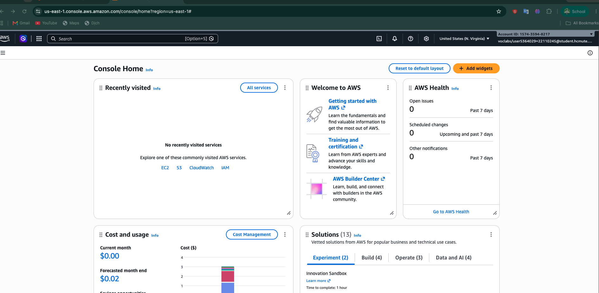
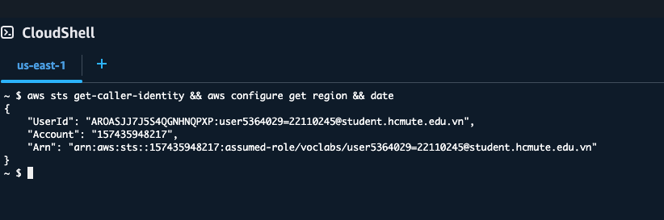

## 2. VPC

1. VPC → Create VPC → **VPC and more**, name tag auto-generation `prom-monitoring`.
2. IPv4 CIDR `10.0.0.0/16`, public subnet `10.0.1.0/24`, private subnet: 0.
3. NAT gateway: None · VPC endpoint: None.
4. Tag `Project=prom-monitoring`, `Owner=<MSSV>`.
5. Subnets → public subnet → Actions → Edit subnet settings → **Enable auto-assign public IPv4 address**.

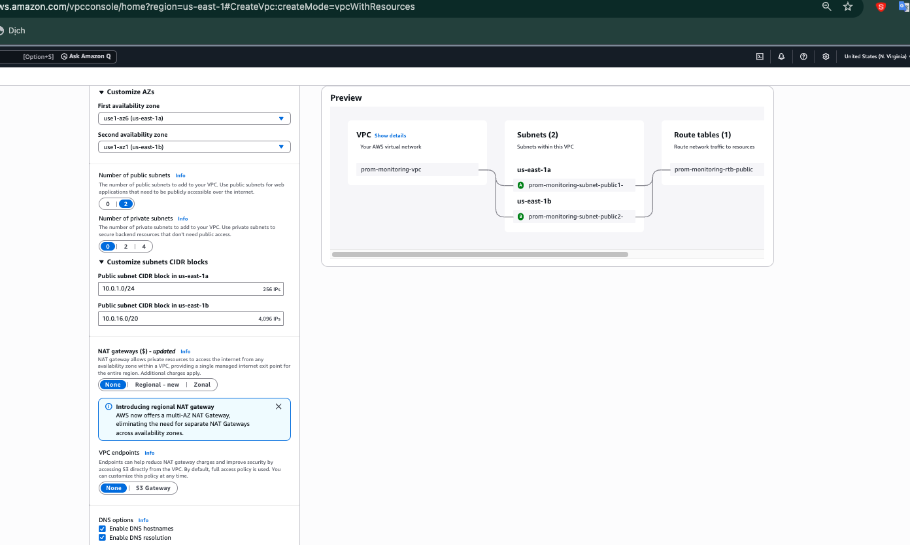
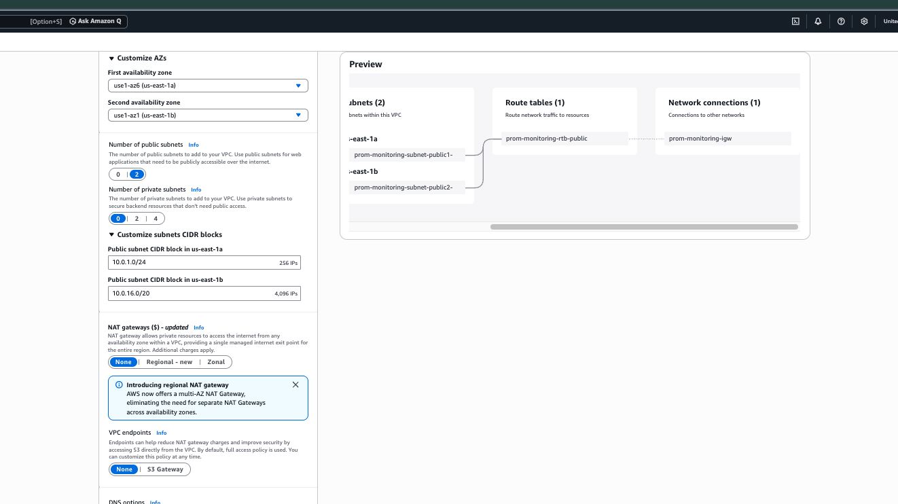
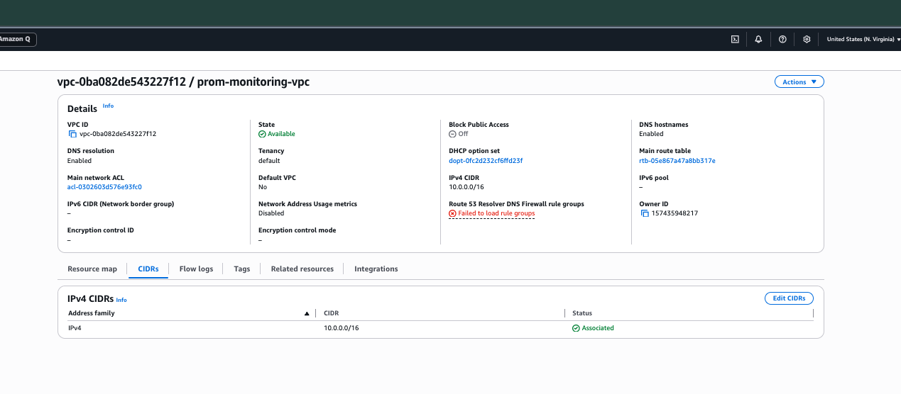
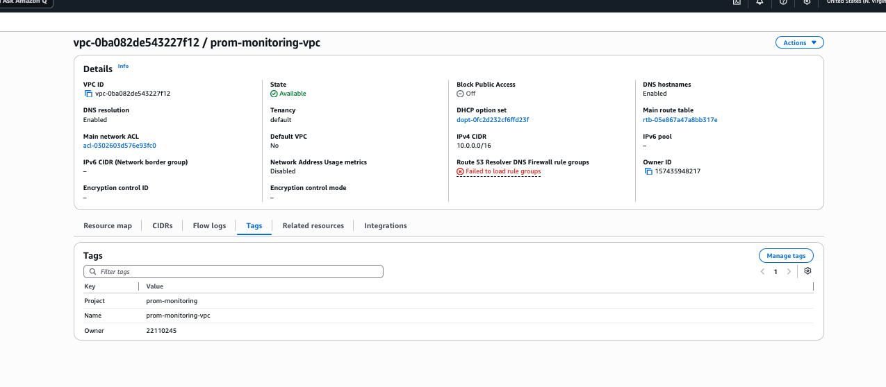
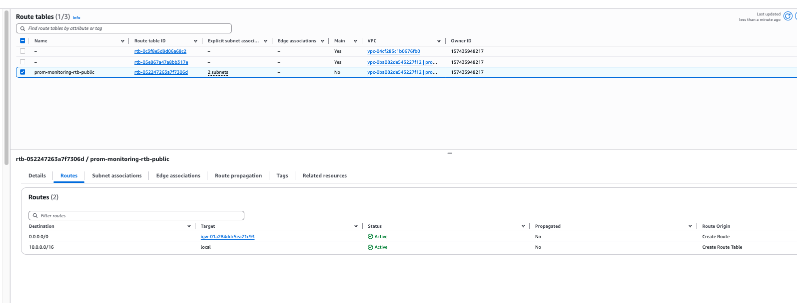

## 3. Security Group

`monitor-sg` (máy monitor):

| Type | Port | Source | Mục đích |
|---|---|---|---|
| SSH | 22 | My IP | Quản trị, SSH tunnel tới Alertmanager |
| Custom TCP | 2404 | My IP | Grafana |
| Custom TCP | 9090 | My IP | Prometheus UI (có basic auth) |

`target-sg` (web-1, web-2, db-1):

| Type | Port | Source | Mục đích |
|---|---|---|---|
| SSH | 22 | My IP | Quản trị |
| Custom TCP | 9100 | My IP | node_exporter |

Outbound giữ mặc định (All traffic). Ở tuần 2, rule 9100 được đổi Source sang `monitor-sg` để chỉ Prometheus scrape được (xem [báo cáo tuần 2](reports/week2.md)).

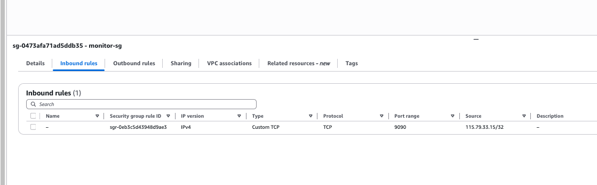
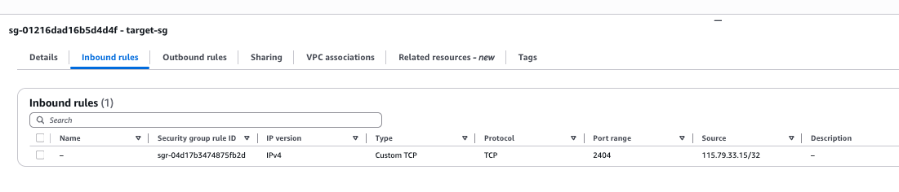

## 4. S3 bucket

1. S3 → Create bucket → `prom-monitoring-<mssv>-backup`, Region `us-east-1`.
2. Block all public access: bật · Bucket Versioning: Enable.
3. Tag `Project`, `Owner`.

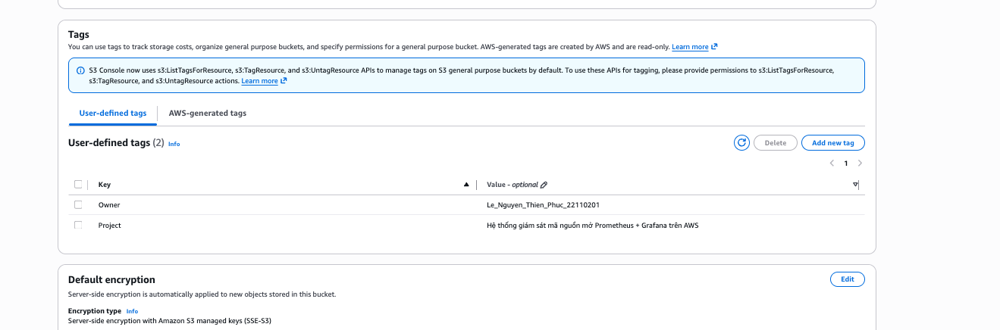

## 5. IAM và kiểm tra tag

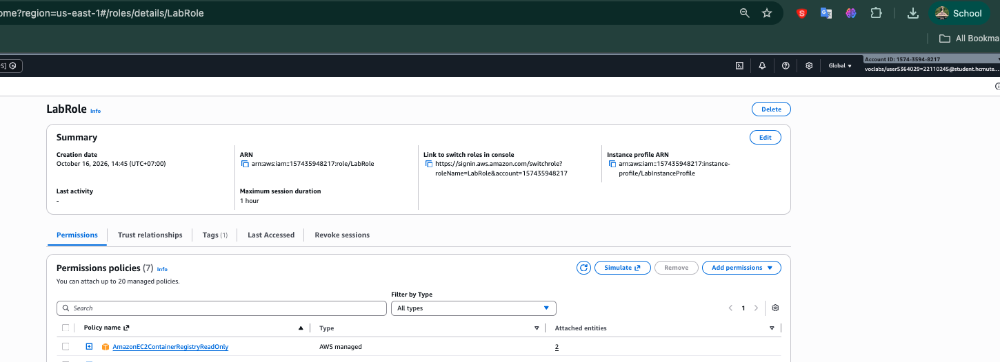
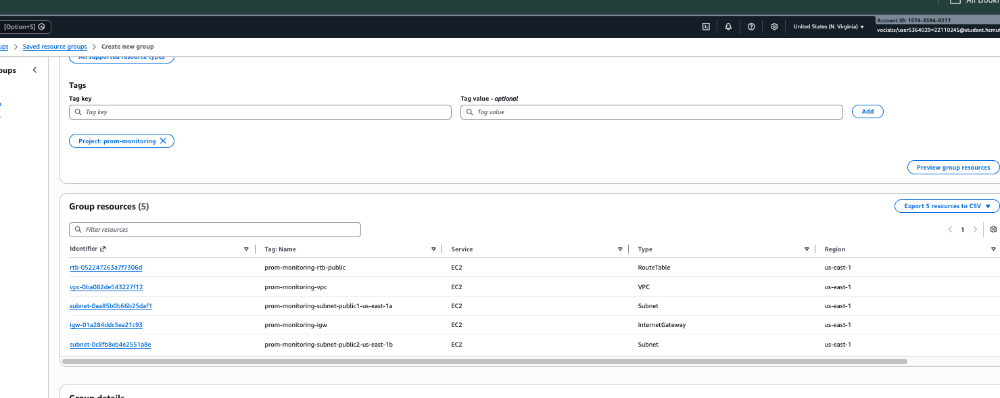

## 6. Lỗi gặp phải

| Lỗi | Nguyên nhân | Cách xử lý |
|---|---|---|
| Không tạo được Security Group tên `sg-monitor`, `sg-target` | AWS không cho tên bắt đầu bằng `sg-` (trùng định dạng Security Group ID) | Đổi tên thành `monitor-sg`, `target-sg` |
| Tag Editor báo `UnknownError` | SCP của AWS Academy chặn API `resource-explorer:ListResourceTypes` | Dùng Resource Groups (tag-based group) và chụp phần Tags của từng tài nguyên (Ảnh 1.10) |
| MSSV trong tag không khớp tài khoản Lab | Nhập nhầm MSSV khi gắn tag | Sửa lại tag tại Properties → Tags của từng tài nguyên |
